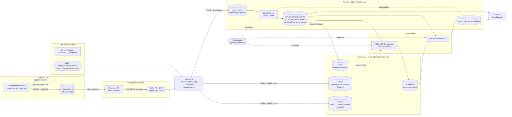

<div align="center">

# Jet Engine Lakehouse

### High-frequency IoT telemetry lakehouse and predictive maintenance for a jet-engine fleet

Change data capture from an operational database, a high-frequency sensor path (kHz vibration
waveforms as Avro over Kafka), a medallion lakehouse on S3, real-time OLAP, dbt feature engineering,
Grafana dashboards and an XGBoost **Remaining Useful Life** model, running on one machine with one command.


</div>

---

## The business problem

An **unscheduled engine removal** is one of the most expensive events in airline operations: the
aircraft is grounded, a spare engine has to be found or leased, and the shop visit is unplanned.
Engines already stream health-monitoring data (exhaust gas temperature, vibration, oil pressure,
fuel flow), so the hard part is turning that stream into a timely, trustworthy answer to one
question:

> **How many flight cycles does this engine have left before it fails?**

Answered early enough, the removal moves from an emergency to the next planned maintenance slot.
This repository builds the complete data platform behind that answer:

| Need | How this platform meets it |
|---|---|
| Capture every operational change, not periodic snapshots | Debezium reads the Postgres WAL: inserts **and** updates arrive as CDC events |
| Keep an immutable, replayable history | Bronze/silver Parquet in an S3 lakehouse, written exactly-once for Spark readers (`_spark_metadata`) |
| Fleet KPIs in seconds | ClickHouse receives CDC rows ~4 s after the source commit (p95 6 s) |
| Full-fidelity sensor data without drowning in it | kHz vibration waveforms bypass the OLTP database (Avro over Kafka), are reduced to spectral features at ingest and tiered to object storage with a 1-day expiry |
| Features without leakage | dbt computes point-in-time rolling windows per engine lifecycle |
| Reproducible models | Versioned artifacts, champion/challenger promotion, run registry |
| Predictions where operators look | Predicted RUL (cycles and hours) stored next to the live sensor readings |

## At a glance

| | |
|---|---|
| **Fleet** | 6 engines (JT9D-7R4, CFM56-7B, GE90-115B), one telemetry pulse per engine per second |
| **Sensors** | 1 Hz summary: core speed (rpm), core temperature, EGT, vibration amplitude, fuel flow, oil pressure |
| **High-frequency frames** | per engine per second also a ~20 KB sensor frame: 2 vibration waveforms at 2,048 Hz and ~80 redundant process channels at 8 Hz; `make load-test` measures full fidelity (16 accelerometers at 25.6 kHz, 1.7 MB per frame) on its own topic |
| **HF throughput** | one Python producer on a laptop: 1,501 frames/s (30 MB/s) at the default fidelity, 178 MB/s at full fidelity; 30 TB per 30 minutes projects to ~94 producers and ~154 brokers ([details](#engine-data-at-scale-the-high-frequency-path)) |
| **Ground truth** | a physics-inspired wear factor w(t) from overhaul (0) to failure (1), see [docs/machine-learning.md](docs/machine-learning.md) |
| **History on first boot** | 24 complete failure-to-repair lifecycles (~45k pulses) backfilled automatically |
| **Freshness** | source commit → ClickHouse: p50 4.2 s, p95 6.3 s; dbt features every 2 min; predictions every cycle |
| **Quality gates** | 110 dbt data tests per run (a failure blocks training and lake snapshots), 878 unit tests (78 of them on a real SparkSession), `make verify` (exits non-zero on any failed check), CI on every push |
| **Model (example run)** | holdout RMSE 15 cycles, R² 0.87; calibrated failure classifier F1 0.87, precision 0.90, ROC-AUC 0.99 |
| **Live backtest** | predictions scored against failures that happened later: RMSE 13–17 cycles, a HIGH warning a median 17–30 cycles before the failure |

## Architecture



| Layer | Service | Image | Role |
|---|---|---|---|
| Edge OLTP | `postgres` | `postgres:15-alpine` | operational tables, `REPLICA IDENTITY FULL`, CDC publication |
| Edge | `simulator` | built from [`simulator/`](simulator) | wears engines out, fails and repairs them; writes INSERTs and UPDATEs; streams one HF sensor frame per engine per second |
| CDC | `debezium` + `cdc-register` | `quay.io/debezium/connect:2.5` | streams WAL changes as JSON envelopes; connector registers itself |
| Backbone | `kafka` + `kafka-init` | `confluentinc/cp-kafka:7.5.0` | KRaft broker; CDC and HF topics created as code (auto-create off) |
| Schemas | `schema-registry` | `confluentinc/cp-schema-registry:7.5.0` | Avro contract of the HF frames, BACKWARD compatibility |
| Processing | `streaming` | built from [`streaming/`](streaming) | 10 Structured Streaming queries: CDC bronze, silver and ClickHouse; HF raw frames, frame features and ClickHouse |
| Lakehouse | `minio` + `minio-init` | `pgsty/minio`, `pgsty/mc` | S3 bucket `lakehouse` with `bronze/ silver/ gold/ ml-artifacts/`; raw HF frames expire after a day |
| OLAP | `clickhouse` | `clickhouse/clickhouse-server:26.8` | raw CDC and HF feature tables, dbt models, predictions |
| Jobs | `orchestrator` | built from [`data_science/Dockerfile`](data_science/Dockerfile) | schedules dbt, snapshots, training and inference |
| Dashboards | `grafana` | built from [`infrastructure/grafana/`](infrastructure/grafana) | 4 provisioned dashboards on a read-only ClickHouse account |

The deep dive into each hop, the CDC event semantics and the data model is in
**[docs/architecture.md](docs/architecture.md)**. The engine physics, features, labels and the
model lifecycle are in **[docs/machine-learning.md](docs/machine-learning.md)**.

## Engine data at scale: the high-frequency path

A 1 Hz summary is what most health monitoring keeps, but an engine's sensors see far more:
hundreds of parameters at tens of hertz and vibration waveforms at kilohertz rates. This platform
takes **30 TB per 30 minutes** (16.7 GB/s for a fleet) as its design target and shows the pattern
that makes such volume tractable: keep raw waveforms out of the operational database, move them as
compact binary records, reduce them to features at ingest, and tier the raw data to cheap storage
that expires.

| Per engine, per second | Laptop default | Full fidelity (`make load-test` flags) |
|---|---|---|
| Vibration waveforms | 2 accelerometers × 2,048 Hz | 16 × 25,600 Hz |
| Process channels | ~80: 40 parameters (N1, N2, EGT, T25, T3, PS3, fuel flow, oil temperature, quantity and filter ΔP, …) on redundant A/B sensors, 8 Hz | 1,000 × 16 Hz (in the projection) |
| Frame on the wire | ~20 KB | ~1.7 MB |

1. **Edge → Kafka.** After each tick's Postgres transaction commits, a background publisher
   thread turns every engine's second into one Avro frame (Confluent wire format; samples as packed
   little-endian float32, so serialization costs next to nothing; zstd) on
   `engine_hf.sensor_frames`, keyed by engine. The frame carries its pulse's `telemetry_id`
   (`INSERT … RETURNING`), so the two paths join exactly. Kafka trouble never stalls the 1 Hz path:
   frames wait in a buffer of `SIM_HF_QUEUE_MAX_MB`; frames that do not fit, or that Kafka has not
   acknowledged within the producer's 5-minute delivery timeout, are dropped and counted, and
   `frame_seq` gaps show exactly which. The first-boot backfill streams a frame for every historical pulse too
   (best effort as well: if the simulator stops before that backlog has reached Kafka, those
   pulses stay without spectral features).
2. **One contract.** [`engine_sensor_frame.avsc`](infrastructure/schemas/engine_sensor_frame.avsc)
   is the single source of truth: the producer registers it in Schema Registry (compatibility
   BACKWARD) and Spark's `from_avro` decodes with the same file.
3. **Reduce at ingest, tier the raw.** Three Spark queries: the raw frames go to bronze, where a
   MinIO lifecycle rule expires them after `HF_BRONZE_RETENTION_DAYS` (1); per-frame features go to
   silver and, every 10 s, into ClickHouse (`raw_engine_hf_features`, plus one throughput row per
   micro-batch in `hf_ingest_batches`). Per vibration channel: RMS, peak, crest factor, kurtosis
   and a Hann-windowed FFT read at the shaft orders (1×N1, 1×N2) and at the bearing's outer-race
   defect frequency (BPFO), high-band energy share and spectral centroid; process channels become
   per-frame means. The features are ~2 % of the raw bytes.
4. **Features for the model and the board.** dbt rolls the frame features into 5-minute means
   (`int_vibration_features`) and `int_ml_features` joins them onto the pulse features: 46 + 10
   spectral features, read the same way by training and scoring. The fleet board raises a
   calibrated **bearing-defect** flag from the BPFO tone and the kurtosis of the fan vibration.

**Measured on this laptop** (`make load-test`: 24 engines for 60 s, one Python producer process,
one local broker, Docker Desktop):

| Fidelity | Frames/s | Delivered MB/s | Wire MB/s (zstd) | Build + serialize p50 / p99 | Errors |
|---|---|---|---|---|---|
| default (2 × 2,048 Hz) | 1,501 | 30.2 | 26.9 | 0.58 / 1.20 ms | 0 |
| full (16 × 25.6 kHz) | 108.6 | 178.3 | 164.1 | 8.3 / 22.2 ms | 0 |

**What 30 TB per 30 minutes takes** (the load test prints this projection): at 1.70 MB/s per
full-fidelity engine, 16.7 GB/s is ~9,800 engines streaming at once; at 178 MB/s per producer
process that is ~94 producers, and at an assumed 100 MB/s of ingest per broker ~167 brokers (154
after zstd), before replication. The consumer side scales on the same axes: topic partitions
(`HF_TOPIC_PARTITIONS`) bound the read parallelism, `HF_MAX_OFFSETS_PER_TRIGGER` bounds every
micro-batch, and the feature workers are vectorized numpy in `mapInPandas`. On this laptop one
Spark driver in local mode worked off the 47,957-frame first-boot backlog (920 MiB of raw frames)
in 24 micro-batches at 1,079 frames/s (22 MB/s) while they ran; the features of those frames take
21.5 MiB in ClickHouse and 12 MiB in silver.

**What the frames add to the analytics, measured.** On a fresh stack's 24 backfilled lifecycles,
the 1 Hz vibration-growth flag fires before every failure whatever its cause (24 of 24, a median
34 cycles ahead). The HF **bearing-defect flag** is a diagnosis instead: it fired in all 6
bearing-degradation and all 4 oil-leak lifecycles (oil-starved bearings; a median 29 and 14 cycles
ahead), in none of the 14 hot-section or compressor failures, and on no pulse with more than 100
cycles of life left, which tells the shop which part to have on the shelf. For the RUL estimate the
spectral features add nothing measurable in this simulation, where the 1 Hz summary already tracks
the wear: over 8 different lifecycle splits the holdout RMSE was 12.0 cycles with them and 11.4
without, and only the failure probability came out slightly better calibrated (lower Brier score
in 7 of 8 splits). Every training run logs this with-and-without comparison
([ML deep dive](docs/machine-learning.md)), so the evidence grows with the fleet's history.

## Quickstart

**Prerequisites:** Docker Engine or Docker Desktop with Compose v2 (give Docker ~10 GB of RAM; the
stack idles at ~6.5 GB as `docker stats` counts it, Spark and Kafka about 2 GB each) and GNU `make`. On Windows, run the commands from Git Bash; if you have no
`make`, every target has a plain `docker compose` equivalent ([see below](#without-make)).

```bash
git clone https://github.com/mahanfatehian/jet-engine-lakehouse.git
cd jet-engine-lakehouse

# Optional: every variable already has a default inside docker-compose.yml.
cp infrastructure/.env.example infrastructure/.env

make up            # build 4 images and start 13 services; the CDC connector registers itself
make ps            # wait until services are healthy and the init jobs exited with 0
make register-cdc  # registers or updates the connector, restarts a FAILED task, waits for RUNNING
make stream        # follow Spark: "clickhouse batch N: engine_telemetry=30 ..." every 5 s
make dbt-run       # dbt build: 12 models + 110 data tests
make train-ml      # train, evaluate and promote the RUL model; artifacts land in MinIO
make predict-ml    # score every engine; predictions land in ClickHouse
make verify        # end-to-end report across Postgres, Debezium, MinIO and ClickHouse
make load-test     # HF producer load test with the 30 TB / 30 min projection
```

Then open the dashboards at **http://localhost:3000** (`admin` / `admin`).

The first `make up` downloads the base images plus Spark, the connector jars and the Python
wheels, which takes a while on a slow link; later builds come from the Docker cache.

You do not have to run the last five steps by hand: the **orchestrator** runs dbt every two
minutes, trains a first model as soon as enough completed lifecycles exist (immediately, thanks to
the backfill), predicts after every dbt cycle and retrains every 30 minutes when new failures have
been observed. The `make` targets run the same jobs on demand and share the scheduler's per-job
locks, so a manual `make dbt-run` waits for a scheduled dbt run instead of colliding with it.

<a id="without-make"></a>
<details>
<summary><b>Without make (plain Docker Compose)</b></summary>

```bash
C="docker compose -f infrastructure/docker-compose.yml"
$C up -d --build                                                   # make up
$C run --rm cdc-register                                           # make register-cdc
$C logs -f streaming                                               # make stream
$C run --rm orchestrator python orchestration/pipeline_runner.py task dbt-build   # make dbt-run
$C run --rm orchestrator python orchestration/pipeline_runner.py task train       # make train-ml
$C run --rm orchestrator python orchestration/pipeline_runner.py task predict     # make predict-ml
$C run --rm --no-deps simulator python engine_generator.py --benchmark            # make load-test
$C down                                                            # make down (data is kept)
```

Extra arguments for the underlying script go after `--`, for example
`... task train -- --promotion-policy always`.
</details>

## Verify the data flow

`make verify` prints all of this in one report. The individual checks:

**1. Source of truth (Postgres)**: `make psql`

```sql
SELECT status, count(*) FROM engine_telemetry GROUP BY status ORDER BY count(*) DESC;
SELECT engine_id, operational_status, current_lifecycle_id, current_cycle,
       round(wear_factor::numeric, 3) AS wear
FROM engine_status_registry ORDER BY engine_id;
```

**2. CDC events in Kafka**

```bash
docker compose -f infrastructure/docker-compose.yml exec kafka kafka-console-consumer \
  --bootstrap-server localhost:29092 --topic engine_cdc.public.engine_status_registry \
  --from-beginning --max-messages 1
```

**3. Lakehouse objects in MinIO** (or browse http://localhost:9001 as `minioadmin` / `minioadmin`)

```bash
docker compose -f infrastructure/docker-compose.yml exec minio sh -c \
  'mc alias set lake http://localhost:9000 "$MINIO_ROOT_USER" "$MINIO_ROOT_PASSWORD" >/dev/null &&
   mc ls --recursive lake/lakehouse/silver/engine_telemetry | head'
```

**4. ClickHouse**: `make ch-client`, or the web UI at http://localhost:8123/play
(user `clickhouse`, password `clickhouse`, database `iot_engine`)

```sql
-- CDC rows landed; FINAL collapses replays and updates to the latest image per key
SELECT count() AS row_versions,
       (SELECT count() FROM raw_engine_telemetry FINAL WHERE is_deleted = 0) AS current_rows
FROM raw_engine_telemetry;

-- The degradation signal the model learns from, grouped by the hidden wear factor
SELECT multiIf(wear_factor < 0.5, '1 HEALTHY', wear_factor < 0.8, '2 WARNING',
               wear_factor < 1, '3 CRITICAL', '4 FAILURE') AS wear_band,
       count() AS pulses, round(avg(egt_c), 1) AS egt_c,
       round(avg(vibration_mm_s), 2) AS vibration_mm_s, round(avg(oil_pressure_psi), 2) AS oil_psi
FROM raw_engine_telemetry FINAL WHERE is_deleted = 0
GROUP BY wear_band ORDER BY wear_band;
```

```text
┌─wear_band──┬─pulses─┬─egt_c─┬─vibration_mm_s─┬─oil_psi─┐
│ 1 HEALTHY  │  40332 │ 657.1 │           1.33 │   52.35 │
│ 2 WARNING  │   7459 │ 707.6 │           2.66 │   51.57 │
│ 3 CRITICAL │   3854 │ 763.3 │           4.58 │   48.67 │
│ 4 FAILURE  │     24 │ 786.2 │           5.98 │   45.21 │
└────────────┴────────┴───────┴────────────────┴─────────┘
```

```sql
-- Live sensor readings next to the predicted Remaining Useful Life
SELECT engine_id, cycle_number, egt_c, vibration_mm_s, oil_pressure_psi,
       round(predicted_rul_cycles, 1) AS rul_cycles, round(predicted_rul_hours, 1) AS rul_hours,
       round(failure_probability, 3) AS p_fail, risk_band
FROM v_engine_rul_latest ORDER BY predicted_rul_cycles;
```

```text
┌─engine_id─┬─cycle_number─┬──egt_c─┬─vibration_mm_s─┬─oil_pressure_psi─┬─rul_cycles─┬─rul_hours─┬─p_fail─┬─risk_band─┐
│ CFM56-104 │          138 │  747.4 │          2.717 │            44.45 │       39.1 │      78.3 │  0.541 │ HIGH      │
│ GE90-201  │          124 │ 679.23 │          1.462 │            59.38 │       53.2 │     106.5 │  0.001 │ LOW       │
│ JT9D-002  │          115 │ 618.01 │          1.519 │            51.81 │       71.8 │     143.6 │  0.001 │ LOW       │
│ GE90-202  │           81 │ 695.27 │          1.311 │            60.26 │      121.5 │       243 │  0.001 │ LOW       │
└───────────┴──────────────┴────────┴────────────────┴──────────────────┴────────────┴───────────┴────────┴───────────┘
```

```sql
-- Fleet health board (gold): drift KPIs, anomaly flags, health score and the latest prediction,
-- aged to the current cycle (the raw prediction is up to one dbt interval old)
SELECT engine_id, operational_status, current_cycle, round(egt_c_drift, 1) AS egt_drift_c,
       round(vibration_mm_s_ratio, 2) AS vib_ratio, anomaly_count, round(health_score, 1) AS health,
       round(predicted_rul_cycles_adjusted, 1) AS rul_cycles_now, risk_band_adjusted AS risk_now
FROM fct_engine_health_status ORDER BY health_score;

-- Training labels: RUL counts down to exactly 0 at the failure pulse of every lifecycle
SELECT split_group, max(rul_cycles) AS cycles_to_failure, min(rul_cycles) AS rul_at_failure,
       any(failure_mode) AS failure_mode
FROM mart_rul_training_features GROUP BY split_group ORDER BY split_group LIMIT 5;

-- Model registry: every training run with its holdout metrics and promotion decision
SELECT model_version, train_lifecycles, test_lifecycles, round(rmse, 2) AS rmse,
       round(r2, 3) AS r2, round(clf_f1, 3) AS f1, promoted
FROM ml_model_runs ORDER BY trained_at DESC;

-- Live backtest (gold): every prediction scored against the failures that have happened since
SELECT model_version, engine_model, predictions_scored AS n, lifecycles_covered AS lifecycles,
       round(rmse_cycles, 2) AS rmse, round(bias_cycles, 2) AS bias, round(clf_f1, 3) AS f1,
       median_warning_lead_cycles AS lead_cycles
FROM rpt_model_live_performance ORDER BY model_version, engine_model;

-- ClickHouse can query the silver lake in MinIO directly. s3() lists every part file and
-- ignores Spark's _spark_metadata, so count distinct change events rather than rows.
SELECT uniqExact(telemetry_id, cdc_lsn)
FROM s3('http://minio:9000/lakehouse/silver/engine_telemetry/*/*.parquet',
        'minioadmin', 'minioadmin', 'Parquet');
```

After nine hours the backtest covered four model versions, each scored on the 11–28 lifecycles
that failed after it went live: RMSE 13–17 cycles, failure recall 0.88–0.96, and a HIGH-risk
warning a median of 17–30 cycles before the failure.

**5. The high-frequency path**: the frame contract in Schema Registry, then the frames in ClickHouse

```bash
curl -s http://localhost:8081/subjects                  # ["engine_hf.sensor_frames-value"]
curl -s http://localhost:8081/config                    # {"compatibilityLevel":"BACKWARD"}
```

```sql
-- One frame per pulse and engine, keyed by the pulse's telemetry_id. The bearing defect tone (BPFO)
-- and the kurtosis spike on every engine whose history holds a bearing or oil-system failure:
-- all but GE90-201, whose four lifecycles ended in hot-section or compressor failures
SELECT engine_id, count() AS frames, round(avg(frame_bytes) / 1024, 1) AS avg_frame_kib,
       round(avg(fan_rms), 2) AS fan_rms_mm_s, round(quantile(0.99)(fan_amp_bpfo), 2) AS bpfo_p99_mm_s,
       round(max(fan_kurtosis), 1) AS kurtosis_max
FROM raw_engine_hf_features FINAL GROUP BY engine_id ORDER BY engine_id;
```

```text
┌─engine_id─┬─frames─┬─avg_frame_kib─┬─fan_rms_mm_s─┬─bpfo_p99_mm_s─┬─kurtosis_max─┐
│ CFM56-104 │   9542 │          19.6 │         1.65 │          4.03 │         21.3 │
│ CFM56-105 │   8080 │          19.6 │         1.57 │          3.09 │          9.4 │
│ GE90-201  │   9282 │          19.6 │         1.68 │          0.41 │          2.5 │
│ GE90-202  │   8967 │          19.6 │         1.79 │          4.55 │         36.5 │
│ JT9D-001  │   8681 │          19.6 │         1.93 │          3.96 │         10.6 │
│ JT9D-002  │   8449 │          19.6 │         1.99 │          4.12 │         12.1 │
└───────────┴────────┴───────────────┴──────────────┴───────────────┴──────────────┘
```

```sql
-- Throughput of the HF micro-batches, and the bearing-defect flag on the fleet board
SELECT count() AS batches, sum(frames) AS total_frames, formatReadableSize(sum(bytes)) AS raw_frames,
       round(total_frames / (sum(duration_ms) / 1000)) AS frames_per_s
FROM hf_ingest_batches;

SELECT engine_id, operational_status, round(fan_amp_bpfo_mean_5m, 2) AS bpfo_mm_s,
       round(fan_kurtosis_mean_5m, 2) AS kurtosis, is_bearing_defect_anomaly, anomaly_count
FROM fct_engine_health_status ORDER BY engine_id;
```

## Dashboards

Grafana (http://localhost:3000, `admin` / `admin`, anonymous access off) opens on the fleet board.
The ClickHouse datasource and the four dashboards are provisioned from
[`infrastructure/grafana/`](infrastructure/grafana), and Grafana reads through a dedicated
ClickHouse account that can only run queries, never write.

| Dashboard | What it answers |
|---|---|
| **Fleet Health & Remaining Useful Life** | status, health score, the five calibrated anomaly flags and the RUL prediction of every engine (aged to the current cycle), live 1 Hz sensors, the failure and repair timeline, failures by mode |
| **Vibration Analytics (HF Sensor Frames)** | bearing defect tone (BPFO), kurtosis, crest factor and core unbalance per engine, the oil system (quantity, filter ΔP, temperatures), the EGT A/B sensor split, HF frames per minute |
| **Data Platform & CDC Pipeline** | CDC ingest rate and end-to-end latency per hop, dead letters, freshness of every pipeline stage, storage footprint, and the HF path's throughput, micro-batch duration, frame lag and coverage per engine |
| **Model Operations & Live Backtest** | the production model, every training run with its promotion decision, calibration of the failure probability, live versus holdout performance against failures that happened later |

## Service endpoints

Every port binds to `127.0.0.1` by default, so the default credentials are only reachable from
this machine; set `BIND_HOST=0.0.0.0` to expose them, after changing the passwords. `make urls`
prints the addresses with the ports from your `infrastructure/.env`.

| Service | Address | Credentials (defaults) |
|---|---|---|
| Grafana dashboards | http://localhost:3000 | `admin` / `admin` |
| MinIO console | http://localhost:9001 | `minioadmin` / `minioadmin` |
| MinIO S3 API | http://localhost:9000 | same |
| ClickHouse web SQL (Play) | http://localhost:8123/play | `clickhouse` / `clickhouse` |
| ClickHouse native | `localhost:19000` | same |
| Debezium REST | http://localhost:8083/connectors/engine-postgres-cdc/status | – |
| Schema Registry | http://localhost:8081/subjects | – |
| Spark UI (Structured Streaming tab) | http://localhost:4040 | – |
| PostgreSQL | `localhost:5432`, database `jet_engine_db` | `admin` / `adminpassword` |
| Kafka (host listener) | `localhost:9092` | – |

## Configuration

Every variable in [`infrastructure/docker-compose.yml`](infrastructure/docker-compose.yml) is written
as `${VAR:-default}`, so the stack boots without any `.env` file. To change something, copy
[`infrastructure/.env.example`](infrastructure/.env.example) (every variable, documented) to
`infrastructure/.env`. The knobs you are most likely to touch:

| Variable | Default | Effect |
|---|---|---|
| `SIM_ENGINE_IDS` | 6 engines | fleet composition; the prefix picks the engine type (JT9D, CFM56, GE90) |
| `SIM_MEAN_LIFE_CYCLES` / `SIM_PULSES_PER_CYCLE` | `180` / `10` | lifecycle length: ~30 min of 1 Hz pulses per engine; a change applies from each engine's next lifecycle |
| `SIM_BACKFILL_LIFECYCLES` | `4` | history generated for every engine without telemetry (first boot, an interrupted first boot, an engine added later) |
| `LAKE_TRIGGER_SECONDS` / `CLICKHOUSE_TRIGGER_SECONDS` | `60` / `5` | micro-batch cadence of Path A / Path B |
| `KAFKA_FAIL_ON_DATA_LOSS` | `true` | a CDC query fails loudly if Kafka retention deleted records it had not read |
| `SIM_HF_ENABLED` | `true` | the high-frequency sensor frames; `false` runs the 1 Hz platform alone (no Kafka client is even loaded) |
| `SIM_HF_SAMPLE_RATE_HZ` / `SIM_HF_VIB_CHANNELS` / `SIM_HF_PROCESS_RATE_HZ` | `2048` / `2` / `8` | frame fidelity of the live fleet; full fidelity (`25600` / `16`) is ~10 MB/s for 6 engines, so measure it with `make load-test`, or size the disks first: up to `HF_TOPIC_RETENTION_BYTES` × 6 partitions in Kafka and ~0.5 TB of bronze per day, kept 1–2 days at `HF_BRONZE_RETENTION_DAYS=1` |
| `HF_TOPIC_RETENTION_BYTES` | `2147483648` | per-partition cap of the HF topic, so frames can never fill the broker disk the CDC topics share |
| `HF_BRONZE_RETENTION_DAYS` / `HF_TOPIC_RETENTION_MS` | `1` / `7200000` | how long raw frames live in the lake (MinIO lifecycle rule) and in Kafka |
| `HF_MAX_OFFSETS_PER_TRIGGER` | `2000` | frames per HF micro-batch: a backlog is worked off in bounded batches |
| `SPECTRAL_MAX_LAG_SECONDS` | `60` | scoring carries spectral features forward this far while the newest frames are still in flight |
| `PIPELINE_GATE_ON_DBT_TESTS` | `true` | a failed dbt test skips training and lake snapshots in that cycle |
| `BIND_HOST` | `127.0.0.1` | interface every published port binds to |
| `DBT_INTERVAL_SECONDS` / `TRAIN_INTERVAL_SECONDS` | `120` / `1800` | orchestration cadence |
| `RUL_FAILURE_HORIZON_CYCLES` / `RUL_CAP_CYCLES` | `25` / `125` | "imminent failure" horizon and RUL target cap (dbt reads the same values) |
| `FLIGHT_HOURS_PER_CYCLE` | `2.0` | converts predicted cycles into hours |
| `MODEL_PROMOTION_POLICY` | `better` | promote only if the challenger beats the champion on the same holdout |
| `*_PORT` | see table above | host ports, if something on your machine already uses them |

## Operating the stack

| Command | What it does |
|---|---|
| `make ps`, `make logs SERVICE=simulator` | status of every service; follow one service's logs |
| `make urls` | addresses of every web UI and API |
| `make cdc-status` | Debezium connector and task state (exit 1 unless RUNNING) |
| `make register-cdc ARGS=--dry-run` | show what registration would change, without changing it |
| `make pipeline-once` | dbt → snapshot → train → predict once, outside the schedule |
| `make snapshot` | export silver/gold feature tables to MinIO Parquet now |
| `make train-ml ARGS="--promotion-policy always"` | force-promote a freshly trained model |
| `make dbt-run ARGS="--full-refresh"` | rebuild every dbt model from the raw CDC tables |
| `make ch-init` | re-apply the idempotent ClickHouse schema (ClickHouse also does it on every start) |
| `make load-test`, `make load-test LOAD_TEST_ARGS="--benchmark-sample-rate 25600 --benchmark-vib-channels 16"` | HF producer load test at the default or at full fidelity, on its own topic (`engine_hf.benchmark`, 10-minute retention) |
| `make down` / `make up` | stop and start again; all data and stream offsets are kept (for outages shorter than the 7-day Kafka retention) |
| `make clean` | **deletes every volume** (Postgres, Kafka, MinIO, ClickHouse, Spark checkpoints) |
| `make test`, `make lint` | every unit test (data-platform image, the Spark tests in the streaming image, the Avro round trip in the simulator image); ruff lint and format check |

<details>
<summary><b>Troubleshooting</b></summary>

- **A port is already in use:** set the matching `*_PORT` variable in `infrastructure/.env`.
- **`streaming` logs "query ... failed ... restarting it from its checkpoint":** a dependency of
  that query is down (ClickHouse for `clickhouse_raw`, MinIO for the lake queries). The supervisor
  restarts it with backoff (2 s up to 60 s) while the other queries keep running.
  `docker exec de_streaming cat /tmp/streaming.heartbeat` shows every query's state and last error.
- **`streaming` stops a query "at a gap in the Kafka CDC log":** the job was down longer than the
  Kafka retention, so records it never read are gone. For `clickhouse_raw`, delete its checkpoint
  (`/opt/spark-checkpoints/clickhouse_raw`; the raw tables are idempotent); for a lake query, run
  once with `KAFKA_FAIL_ON_DATA_LOSS=false` until it commits past the gap, then set it back.
- **After a power loss or hard reset, a query keeps restarting with "Incomplete log file" or "Log
  file was malformed":** the newest checkpoint entries of that query were not flushed to disk.
  Delete the empty or zero-filled newest files under `offsets/` and `commits/` of
  `/opt/spark-checkpoints/<query>` together with their `.crc` files
  (`docker exec de_streaming ...`); the query then replays its last batch. That is harmless for the
  ClickHouse queries (idempotent tables). Deleting the whole checkpoint of a ClickHouse query works
  too, at the cost of re-reading the topic.
- **`simulator` exits with code 2:** either another simulator is already writing to the database
  (stop it; the container takes over within a minute), or a database written before per-lifecycle
  settings existed was restarted with different `SIM_*` values: restore them for one start.
- **No predictions yet:** the first model trains right after the first dbt run;
  `make logs SERVICE=orchestrator` shows each task as SUCCESS, SKIPPED or FAILED.
- **No HF frames, or the HF check of `make verify` says WARN:** the HF path is best effort and
  never blocks the 1 Hz path. `make logs SERVICE=simulator` shows "HF frames waiting for Kafka"
  while the topic or the registry is not up yet, and a metrics line every minute (produced,
  dropped, MB/s, queue depth). Spectral features stay NULL for pulses without a frame; the models
  treat them as missing.
- **Connector not RUNNING:** `make cdc-status`, then `make register-cdc` (it restarts a FAILED task
  and resumes a PAUSED connector).
- **A manual `make dbt-run` or `make train-ml` seems to hang:** it is waiting for the scheduled run
  of the same job to finish (shared locks), then runs with the scheduler's timeouts.
- **MinIO image:** MinIO Inc. no longer publishes the `minio/minio` and `minio/mc` images, so the
  stack pins the maintained community builds `pgsty/minio` and `pgsty/mc` (same binaries, CLI
  and S3 API). Override them with `MINIO_IMAGE` / `MC_IMAGE`.
- **Line endings on Windows:** `.gitattributes` forces LF, so shell and SQL files mounted into
  Linux containers work even with `core.autocrlf=true`.
</details>

## Project structure

```text
jet-engine-lakehouse/
├── infrastructure/
│   ├── docker-compose.yml          # 13 services, healthchecks, ${VAR:-default} everywhere
│   ├── .env.example                # every variable with its default, documented
│   ├── postgres/init.sql           # OLTP schema, REPLICA IDENTITY FULL, CDC publication
│   ├── debezium/                   # connector config + idempotent registration script
│   ├── kafka/create-topics.sh      # CDC and HF topics as code
│   ├── schemas/engine_sensor_frame.avsc  # Avro contract of the HF sensor frames
│   ├── minio/init-buckets.sh       # lakehouse bucket, medallion zones, raw-frame expiry
│   ├── clickhouse/                 # raw/serving DDL (init-db.sql), read-only Grafana user, verify.sql
│   └── grafana/                    # image with the ClickHouse plugin, datasource, 4 dashboards
├── simulator/                      # fleet physics, Postgres writer, HF frame producer, load test
├── streaming/                      # Spark Structured Streaming: Kafka -> MinIO + ClickHouse, FFT features
├── analytics/                      # dbt-clickhouse project: silver + gold models and tests
├── data_science/                   # features, RUL training, inference, snapshots (+ job image)
├── orchestration/pipeline_runner.py  # lightweight scheduler for dbt, snapshots, train, predict
├── tests/                          # unit tests per component + dbt integration harness
├── docs/                           # architecture and machine-learning deep dives
├── Makefile                        # developer entry points (docker + make only)
└── README.md
```

## Testing

- **Unit tests:** `make test` runs `make test-platform` (simulator physics, HF frames and
  signatures, ML pipeline, registry, scheduler, in the data-platform image), `make test-streaming`
  (CDC parsing, Avro decoding, the FFT features, the query supervisor and the ClickHouse sinks
  with real Spark, in the streaming image, failing on any skipped test) and `make test-simulator`
  (the frames against the real Avro schema, in the simulator image).
- **Data tests:** every orchestrated dbt cycle runs the dbt tests (CDC dedup, label consistency,
  finite features, calibrated anomaly thresholds including the bearing-defect flag, one fleet row
  per engine, backtest invariants, HF frame dedup, finite non-negative spectral features, one ML
  feature row per pulse, ...); a failure blocks training and lake snapshots for that cycle.
- **CI:** GitHub Actions runs lint, the three unit-test suites, the dbt integration harness and a
  compose check on every push and pull request, plus a nightly full-stack smoke test.
- **dbt integration harness:** `bash tests/analytics/run_dbt_integration.sh` seeds a throwaway
  ClickHouse with synthetic CDC (duplicates, updates, deletes, late rows) and the matching
  high-frequency frame features (dropped frames, NaN features, absent process keys, redelivered,
  late and corrected copies, a bearing spall), checks every spectral feature against an
  independent Python reference and proves that the incremental models equal a full refresh.
- **Lint:** `make lint` (ruff check + format check).

## Production hardening notes

This is a single-node reference platform. What is already in place:
- every published port binds to `127.0.0.1` unless `BIND_HOST` says otherwise;
- model bundles are verified by SHA-256 before they are unpickled;
- ClickHouse's own log tables expire after 3–7 days (profiling logs are off);
- a stalled CDC replication slot can pin at most `PG_MAX_SLOT_WAL_KEEP_SIZE` (4 GB) of WAL;
- the third-party MinIO images are pinned by digest.

Before running it anywhere real: replace every default credential (MinIO, ClickHouse, Postgres)
and keep `.env` out of version control; give Debezium a dedicated replication role instead of the
superuser; run Kafka with three brokers and replication factor 3; enable TLS on every endpoint;
add retention to the silver and gold lake layers; and keep the lakehouse bucket writable only by
the training job, because whoever can rewrite `production.json` can also forge its digest.

**Upgrading an existing stack:** a `production.json` written before bundle digests existed is not
loaded; the next scheduled training promotes a digest-carrying model (in its first cycle), and
predictions resume. One-off: run `make dbt-run ARGS="--full-refresh --select int_sensor_rolling_features+"`
once, because that incremental model gained a column. The high-frequency path upgrades in place
(`make up`): ClickHouse re-applies its idempotent schema on every start, which creates the HF
tables on an existing volume (`make ch-init` does the same by hand); the new dbt models build in
the next cycle; a production model trained without spectral features keeps scoring and is
compared with the first challenger that has them; and the history from before the upgrade has no
spectral features, so the spectral ablation reports "skipped" until lifecycles recorded with HF
frames complete.
