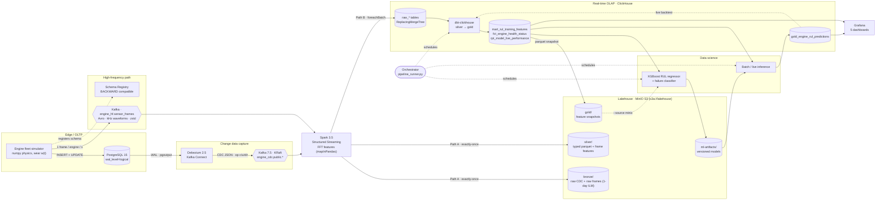

<div align="center">

# Jet Engine Lakehouse

### High-frequency IoT telemetry lakehouse and predictive maintenance for a jet-engine fleet

Change data capture from an operational database, a high-frequency sensor path (kHz vibration
waveforms as Avro over Kafka), a medallion lakehouse on S3, real-time OLAP, dbt feature engineering,
Grafana dashboards and an XGBoost **Remaining Useful Life** model, running on one machine with one command.


</div>

---

## The business problem

An **unscheduled engine removal** is one of the most expensive events in airline operations: the
aircraft is grounded, a spare engine has to be found or leased, and the shop visit is unplanned.
Engines already stream health-monitoring data (exhaust gas temperature, vibration, oil pressure,
fuel flow), so the hard part is turning that stream into a timely, trustworthy answer to one
question:

> **How many flight cycles does this engine have left before it fails?**

Answered early enough, the removal moves from an emergency to the next planned maintenance slot.
This repository builds the complete data platform behind that answer:

| Need | How this platform meets it |
|---|---|
| Capture every operational change, not periodic snapshots | Debezium reads the Postgres WAL: inserts **and** updates arrive as CDC events |
| Keep an immutable, replayable history | Bronze/silver Parquet in an S3 lakehouse, written exactly-once for Spark readers (`_spark_metadata`) |
| Fleet KPIs in seconds | ClickHouse receives CDC rows ~4 s after the source commit (p95 6 s) |
| Full-fidelity sensor data without drowning in it | kHz vibration waveforms bypass the OLTP database (Avro over Kafka), are reduced to spectral features at ingest and tiered to object storage with a 1-day expiry |
| Features without leakage | dbt computes point-in-time rolling windows per engine lifecycle |
| Reproducible models | Versioned artifacts, champion/challenger promotion, run registry |
| Predictions where operators look | Predicted RUL (cycles and hours) stored next to the live sensor readings |

## At a glance

| | |
|---|---|
| **Fleet** | 6 engines (JT9D-7R4, CFM56-7B, GE90-115B), one telemetry pulse per engine per second |
| **Sensors** | 1 Hz summary: core speed (rpm), core temperature, EGT, vibration amplitude, fuel flow, oil pressure |
| **High-frequency frames** | per engine per second also a ~20 KB sensor frame: 2 vibration waveforms at 2,048 Hz and ~80 redundant process channels at 8 Hz; `make load-test` measures full fidelity (16 accelerometers at 25.6 kHz, 1.7 MB per frame) on its own topic |
| **HF throughput** | one Python producer on a laptop: 1,501 frames/s (30 MB/s) at the default fidelity, 178 MB/s at full fidelity; 30 TB per 30 minutes projects to ~94 producers and ~154 brokers ([details](#engine-data-at-scale-the-high-frequency-path)) |
| **Ground truth** | a physics-inspired wear factor w(t) from overhaul (0) to failure (1), see [docs/machine-learning.md](docs/machine-learning.md) |
| **History on first boot** | 24 complete failure-to-repair lifecycles (~45k pulses) backfilled automatically |
| **Freshness** | source commit → ClickHouse: p50 4.2 s, p95 6.3 s; dbt features every 2 min; predictions every cycle |
| **Quality gates** | 168 dbt data tests per run (a failure blocks training and lake snapshots), an end-to-end reconciliation audit every 16 minutes (PostgreSQL source = raw = staging = silver lake, per engine and hour), 1,221 unit tests (85 of them on a real SparkSession), `make verify` (exits non-zero on any failed check), CI on every push |
| **Model (example run)** | holdout RMSE 15 cycles, R² 0.87; calibrated failure classifier F1 0.87, precision 0.90, ROC-AUC 0.99 |
| **Live backtest** | predictions scored against failures that happened later: RMSE 13–17 cycles, a HIGH warning a median 17–30 cycles before the failure |

## Architecture



| Layer | Service | Image | Role |
|---|---|---|---|
| Edge OLTP | `postgres` + `postgres-init` | `postgres:15-alpine` | operational tables, `REPLICA IDENTITY FULL`, CDC publication; least-privilege roles for Debezium and the reconciliation audit, re-applied on every `up` |
| Edge | `simulator` | built from [`simulator/`](simulator) | wears engines out, fails and repairs them; writes INSERTs and UPDATEs; streams one HF sensor frame per engine per second |
| CDC | `debezium` + `cdc-register` | `quay.io/debezium/connect:2.5` | streams WAL changes as JSON envelopes; connector registers itself |
| Backbone | `kafka` + `kafka-init` | `confluentinc/cp-kafka:7.5.0` | KRaft broker; CDC and HF topics created as code (auto-create off) |
| Schemas | `schema-registry` | `confluentinc/cp-schema-registry:7.5.0` | Avro contract of the HF frames, BACKWARD compatibility |
| Processing | `streaming` | built from [`streaming/`](streaming) | 10 Structured Streaming queries: CDC bronze, silver and ClickHouse; HF raw frames, frame features and ClickHouse |
| Lakehouse | `minio` + `minio-init` | `pgsty/minio`, `pgsty/mc` | S3 bucket `lakehouse` with `bronze/ silver/ gold/ ml-artifacts/`; raw HF frames expire after a day |
| OLAP | `clickhouse` | `clickhouse/clickhouse-server:26.8` | raw CDC and HF feature tables, dbt models, predictions |
| Jobs | `orchestrator` | built from [`data_science/Dockerfile`](data_science/Dockerfile) | schedules dbt, snapshots, training and inference |
| Dashboards | `grafana` | built from [`infrastructure/grafana/`](infrastructure/grafana) | 5 provisioned dashboards on a read-only ClickHouse account |

The deep dive into each hop, the CDC event semantics and the data model is in
**[docs/architecture.md](docs/architecture.md)**. The engine physics, features, labels and the
model lifecycle are in **[docs/machine-learning.md](docs/machine-learning.md)**.

## Engine data at scale: the high-frequency path

A 1 Hz summary is what most health monitoring keeps, but an engine's sensors see far more:
hundreds of parameters at tens of hertz and vibration waveforms at kilohertz rates. This platform
takes **30 TB per 30 minutes** (16.7 GB/s for a fleet) as its design target and shows the pattern
that makes such volume tractable: keep raw waveforms out of the operational database, move them as
compact binary records, reduce them to features at ingest, and tier the raw data to cheap storage
that expires.

| Per engine, per second | Laptop default | Full fidelity (`make load-test` flags) |
|---|---|---|
| Vibration waveforms | 2 accelerometers × 2,048 Hz | 16 × 25,600 Hz |
| Process channels | ~80: 40 parameters (N1, N2, EGT, T25, T3, PS3, fuel flow, oil temperature, quantity and filter ΔP, …) on redundant A/B sensors, 8 Hz | 1,000 × 16 Hz (in the projection) |
| Frame on the wire | ~20 KB | ~1.7 MB |

1. **Edge → Kafka.** After each tick's Postgres transaction commits, a background publisher
   thread turns every engine's second into one Avro frame (Confluent wire format; samples as packed
   little-endian float32, so serialization costs next to nothing; zstd) on
   `engine_hf.sensor_frames`, keyed by engine. The frame carries its pulse's `telemetry_id`
   (`INSERT … RETURNING`), so the two paths join exactly. Kafka trouble never stalls the 1 Hz path:
   frames wait in a buffer of `SIM_HF_QUEUE_MAX_MB` that holds both the frames not yet handed to
   Kafka and those Kafka has not acknowledged. The producer has no delivery timeout, so the buffer,
   not a timer, bounds an outage: about 37 minutes of the default fleet's frames at 256 MiB. Frames
   that do not fit are dropped and counted, and `frame_seq` gaps show exactly which. The first-boot
   backfill streams a frame for every historical pulse too, and that backlog survives a stop: each
   engine's history transaction also records the frames it owes (`simulator_hf_backfill`), the
   record is deleted only once Kafka has acknowledged every one of them, and a start that finds one
   rebuilds those frames from the stored pulses and the per-lifecycle settings (same
   `telemetry_id`, `frame_seq` and physics, byte-identical under an unchanged `SIM_SEED`) and queues
   them again; a frame that arrives twice collapses into one row of `raw_engine_hf_features`.
2. **One contract.** [`engine_sensor_frame.avsc`](infrastructure/schemas/engine_sensor_frame.avsc)
   is the single source of truth: the producer registers it in Schema Registry (compatibility
   BACKWARD) and Spark's `from_avro` decodes with the same file.
3. **Reduce at ingest, tier the raw.** Three Spark queries: the raw frames go to bronze, where a
   MinIO lifecycle rule expires them after `HF_BRONZE_RETENTION_DAYS` (1); per-frame features go to
   silver and, every 10 s, into ClickHouse (`raw_engine_hf_features`, plus one throughput row per
   micro-batch in `hf_ingest_batches`). Per vibration channel: RMS, peak, crest factor, kurtosis
   and a Hann-windowed FFT read at the shaft orders (1×N1, 1×N2) and at the bearing's outer-race
   defect frequency (BPFO), high-band energy share and spectral centroid; process channels become
   per-frame means. The features are ~2 % of the raw bytes.
4. **Features for the model and the board.** dbt rolls the frame features into 5-minute means
   (`int_vibration_features`) and `int_ml_features` joins them onto the pulse features: 46 + 10
   spectral features, read the same way by training and scoring. The fleet board raises a
   calibrated **bearing-defect** flag from the BPFO tone and the kurtosis of the fan vibration.

**Measured on this laptop** (`make load-test`: 24 engines for 60 s, one Python producer process,
one local broker, Docker Desktop):

| Fidelity | Frames/s | Delivered MB/s | Wire MB/s (zstd) | Build + serialize p50 / p99 | Errors |
|---|---|---|---|---|---|
| default (2 × 2,048 Hz) | 1,501 | 30.2 | 26.9 | 0.58 / 1.20 ms | 0 |
| full (16 × 25.6 kHz) | 108.6 | 178.3 | 164.1 | 8.3 / 22.2 ms | 0 |

**What 30 TB per 30 minutes takes** (the load test prints this projection): at 1.70 MB/s per
full-fidelity engine, 16.7 GB/s is ~9,800 engines streaming at once; at 178 MB/s per producer
process that is ~94 producers, and at an assumed 100 MB/s of ingest per broker ~167 brokers (154
after zstd), before replication. The consumer side scales on the same axes: topic partitions
(`HF_TOPIC_PARTITIONS`) bound the read parallelism, `HF_MAX_OFFSETS_PER_TRIGGER` bounds every
micro-batch, and the feature workers are vectorized numpy in `mapInPandas`. On this laptop one
Spark driver in local mode worked off the 47,957-frame first-boot backlog (920 MiB of raw frames)
in 24 micro-batches at 1,079 frames/s (22 MB/s) while they ran; the features of those frames take
21.5 MiB in ClickHouse and 12 MiB in silver.

**What the frames add to the analytics, measured.** On a fresh stack's 24 backfilled lifecycles,
the 1 Hz vibration-growth flag fires before every failure whatever its cause (24 of 24, a median
34 cycles ahead). The HF **bearing-defect flag** is a diagnosis instead: it fired in all 6
bearing-degradation and all 4 oil-leak lifecycles (oil-starved bearings; a median 29 and 14 cycles
ahead), in none of the 14 hot-section or compressor failures, and on no pulse with more than 100
cycles of life left, which tells the shop which part to have on the shelf. For the RUL estimate the
spectral features add little, and only once there is enough history, because the 1 Hz summary
already tracks the wear: on a fresh stack's 24 lifecycles they did not help (over 8 lifecycle
splits the holdout RMSE was 12.0 cycles with them and 11.4 without). `make evaluate-spectral`
repeats the comparison over several lifecycle splits of the training data; on the live stack with
276 lifecycles (5 splits of 56 to 73 holdout lifecycles, every 4th pulse) the spectral features
lowered the holdout RMSE in every split, by 0.28 cycles on average (11.70 vs 11.97; late-life
RMSE 13.12 vs 13.40), while the classifier's F1 barely moved (0.893 vs 0.891). Every training run
logs the same with-and-without comparison on its own holdout ([ML deep dive](docs/machine-learning.md)),
so the evidence grows with the fleet's history. Because training fits the missing-spectral case
too (spectral dropout), an engine whose frames do not land scores almost as well: 12.19 cycles
with every spectral value masked, against 25 before spectral dropout.

| Holdout scoring, 5 splits of 276 lifecycles | RMSE | late-life RMSE | R² | F1 |
|---|---|---|---|---|
| with the spectral features | 11.70 | 13.12 | 0.921 | 0.893 |
| same models, every spectral value masked | 12.19 | 13.72 | 0.914 | 0.888 |
| pulse features only | 11.97 | 13.40 | 0.917 | 0.891 |

## Quickstart

**Prerequisites:** Docker Engine or Docker Desktop with Compose v2 (give Docker ~10 GB of RAM; the
stack idles at ~6.5 GB as `docker stats` counts it, Spark and Kafka about 2 GB each) and GNU `make`. On Windows, run the commands from Git Bash; if you have no
`make`, every target has a plain `docker compose` equivalent ([see below](#without-make)).

```bash
git clone https://github.com/mahanfatehian/jet-engine-lakehouse.git
cd jet-engine-lakehouse

# Optional: every variable already has a default inside docker-compose.yml.
cp infrastructure/.env.example infrastructure/.env

make up            # build 4 images and start 14 services; the CDC connector registers itself
make ps            # wait until services are healthy and the init jobs exited with 0
make register-cdc  # registers or updates the connector, restarts a FAILED task, waits for RUNNING
make stream        # follow Spark: "clickhouse batch N: engine_telemetry=30 ..." every 5 s
make dbt-run       # dbt build: 18 models + 168 data tests
make train-ml      # train, evaluate and promote the RUL model; artifacts land in MinIO
make predict-ml    # score every engine; predictions land in ClickHouse
make verify        # end-to-end report across Postgres, Debezium, MinIO and ClickHouse
make load-test     # HF producer load test with the 30 TB / 30 min projection
```

Then open the dashboards at **http://localhost:3000** (`admin` / `admin`).

The first `make up` downloads the base images plus Spark, the connector jars and the Python
wheels, which takes a while on a slow link; later builds come from the Docker cache.

You do not have to run the last five steps by hand: the **orchestrator** runs dbt every two
minutes, trains a first model as soon as enough completed lifecycles exist (immediately, thanks to
the backfill), predicts after every dbt cycle and retrains every 30 minutes when new failures have
been observed. The `make` targets run the same jobs on demand and share the scheduler's per-job
locks, so a manual `make dbt-run` waits for a scheduled dbt run instead of colliding with it.

<a id="without-make"></a>
<details>
<summary><b>Without make (plain Docker Compose)</b></summary>

```bash
C="docker compose -f infrastructure/docker-compose.yml"
$C up -d --build                                                   # make up
$C run --rm cdc-register                                           # make register-cdc
$C logs -f streaming                                               # make stream
$C run --rm orchestrator python orchestration/pipeline_runner.py task dbt-build   # make dbt-run
$C run --rm orchestrator python orchestration/pipeline_runner.py task train       # make train-ml
$C run --rm orchestrator python orchestration/pipeline_runner.py task predict     # make predict-ml
$C run --rm --no-deps simulator python engine_generator.py --benchmark            # make load-test
bash infrastructure/clickhouse/dr-drill.sh --day 2026-11-01        # make dr-drill
$C down                                                            # make down (data is kept)
```

Extra arguments for the underlying script go after `--`, for example
`... task train -- --promotion-policy always`.
</details>

## Verify the data flow

`make verify` prints all of this in one report. The individual checks:

**1. Source of truth (Postgres)**: `make psql`

```sql
SELECT status, count(*) FROM engine_telemetry GROUP BY status ORDER BY count(*) DESC;
SELECT engine_id, operational_status, current_lifecycle_id, current_cycle,
       round(wear_factor::numeric, 3) AS wear
FROM engine_status_registry ORDER BY engine_id;
```

**2. CDC events in Kafka**

```bash
docker compose -f infrastructure/docker-compose.yml exec kafka kafka-console-consumer \
  --bootstrap-server localhost:29092 --topic engine_cdc.public.engine_status_registry \
  --from-beginning --max-messages 1
```

**3. Lakehouse objects in MinIO** (or browse http://localhost:9001 as `minioadmin` / `minioadmin`)

```bash
docker compose -f infrastructure/docker-compose.yml exec minio sh -c \
  'mc alias set lake http://localhost:9000 "$MINIO_ROOT_USER" "$MINIO_ROOT_PASSWORD" >/dev/null &&
   mc ls --recursive lake/lakehouse/silver/engine_telemetry | head'
```

**4. ClickHouse**: `make ch-client`, or the web UI at http://localhost:8123/play
(user `clickhouse`, password `clickhouse`, database `iot_engine`)

```sql
-- CDC rows landed; FINAL collapses replays and updates to the latest image per key
SELECT count() AS row_versions,
       (SELECT count() FROM raw_engine_telemetry FINAL WHERE is_deleted = 0) AS current_rows
FROM raw_engine_telemetry;

-- The degradation signal the model learns from, grouped by the hidden wear factor
SELECT multiIf(wear_factor < 0.5, '1 HEALTHY', wear_factor < 0.8, '2 WARNING',
               wear_factor < 1, '3 CRITICAL', '4 FAILURE') AS wear_band,
       count() AS pulses, round(avg(egt_c), 1) AS egt_c,
       round(avg(vibration_mm_s), 2) AS vibration_mm_s, round(avg(oil_pressure_psi), 2) AS oil_psi
FROM raw_engine_telemetry FINAL WHERE is_deleted = 0
GROUP BY wear_band ORDER BY wear_band;
```

```text
┌─wear_band──┬─pulses─┬─egt_c─┬─vibration_mm_s─┬─oil_psi─┐
│ 1 HEALTHY  │  40332 │ 657.1 │           1.33 │   52.35 │
│ 2 WARNING  │   7459 │ 707.6 │           2.66 │   51.57 │
│ 3 CRITICAL │   3854 │ 763.3 │           4.58 │   48.67 │
│ 4 FAILURE  │     24 │ 786.2 │           5.98 │   45.21 │
└────────────┴────────┴───────┴────────────────┴─────────┘
```

```sql
-- Live sensor readings next to the predicted Remaining Useful Life
SELECT engine_id, cycle_number, egt_c, vibration_mm_s, oil_pressure_psi,
       round(predicted_rul_cycles, 1) AS rul_cycles, round(predicted_rul_hours, 1) AS rul_hours,
       round(failure_probability, 3) AS p_fail, risk_band
FROM v_engine_rul_latest ORDER BY predicted_rul_cycles;
```

```text
┌─engine_id─┬─cycle_number─┬──egt_c─┬─vibration_mm_s─┬─oil_pressure_psi─┬─rul_cycles─┬─rul_hours─┬─p_fail─┬─risk_band─┐
│ CFM56-104 │          138 │  747.4 │          2.717 │            44.45 │       39.1 │      78.3 │  0.541 │ HIGH      │
│ GE90-201  │          124 │ 679.23 │          1.462 │            59.38 │       53.2 │     106.5 │  0.001 │ LOW       │
│ JT9D-002  │          115 │ 618.01 │          1.519 │            51.81 │       71.8 │     143.6 │  0.001 │ LOW       │
│ GE90-202  │           81 │ 695.27 │          1.311 │            60.26 │      121.5 │       243 │  0.001 │ LOW       │
└───────────┴──────────────┴────────┴────────────────┴──────────────────┴────────────┴───────────┴────────┴───────────┘
```

```sql
-- Fleet health board (gold): drift KPIs, anomaly flags, health score and the latest prediction,
-- aged to the current cycle (the raw prediction is up to one dbt interval old)
SELECT engine_id, operational_status, current_cycle, round(egt_c_drift, 1) AS egt_drift_c,
       round(vibration_mm_s_ratio, 2) AS vib_ratio, anomaly_count, round(health_score, 1) AS health,
       round(predicted_rul_cycles_adjusted, 1) AS rul_cycles_now, risk_band_adjusted AS risk_now
FROM fct_engine_health_status ORDER BY health_score;

-- Training labels: RUL counts down to exactly 0 at the failure pulse of every lifecycle
SELECT split_group, max(rul_cycles) AS cycles_to_failure, min(rul_cycles) AS rul_at_failure,
       any(failure_mode) AS failure_mode
FROM mart_rul_training_features GROUP BY split_group ORDER BY split_group LIMIT 5;

-- Model registry: every training run with its holdout metrics and promotion decision
SELECT model_version, train_lifecycles, test_lifecycles, round(rmse, 2) AS rmse,
       round(r2, 3) AS r2, round(clf_f1, 3) AS f1, promoted
FROM ml_model_runs ORDER BY trained_at DESC;

-- Live backtest (gold): every prediction scored against the failures that have happened since
SELECT model_version, engine_model, predictions_scored AS n, lifecycles_covered AS lifecycles,
       round(rmse_cycles, 2) AS rmse, round(bias_cycles, 2) AS bias, round(clf_f1, 3) AS f1,
       median_warning_lead_cycles AS lead_cycles
FROM rpt_model_live_performance ORDER BY model_version, engine_model;

-- ClickHouse can query the silver lake in MinIO directly. s3() lists every part file and
-- ignores Spark's _spark_metadata, so count distinct change events rather than rows.
SELECT uniqExact(telemetry_id, cdc_lsn)
FROM s3('http://minio:9000/lakehouse/silver/engine_telemetry/*/*.parquet',
        'minioadmin', 'minioadmin', 'Parquet');
```

After nine hours the backtest covered four model versions, each scored on the 11–28 lifecycles
that failed after it went live: RMSE 13–17 cycles, failure recall 0.88–0.96, and a HIGH-risk
warning a median of 17–30 cycles before the failure.

**5. The high-frequency path**: the frame contract in Schema Registry, then the frames in ClickHouse

```bash
curl -s http://localhost:8081/subjects                  # ["engine_hf.sensor_frames-value"]
curl -s http://localhost:8081/config                    # {"compatibilityLevel":"BACKWARD"}
```

```sql
-- One frame per pulse and engine, keyed by the pulse's telemetry_id. The bearing defect tone (BPFO)
-- and the kurtosis spike on every engine whose history holds a bearing or oil-system failure:
-- all but GE90-201, whose four lifecycles ended in hot-section or compressor failures
SELECT engine_id, count() AS frames, round(avg(frame_bytes) / 1024, 1) AS avg_frame_kib,
       round(avg(fan_rms), 2) AS fan_rms_mm_s, round(quantile(0.99)(fan_amp_bpfo), 2) AS bpfo_p99_mm_s,
       round(max(fan_kurtosis), 1) AS kurtosis_max
FROM raw_engine_hf_features FINAL GROUP BY engine_id ORDER BY engine_id;
```

```text
┌─engine_id─┬─frames─┬─avg_frame_kib─┬─fan_rms_mm_s─┬─bpfo_p99_mm_s─┬─kurtosis_max─┐
│ CFM56-104 │   9542 │          19.6 │         1.65 │          4.03 │         21.3 │
│ CFM56-105 │   8080 │          19.6 │         1.57 │          3.09 │          9.4 │
│ GE90-201  │   9282 │          19.6 │         1.68 │          0.41 │          2.5 │
│ GE90-202  │   8967 │          19.6 │         1.79 │          4.55 │         36.5 │
│ JT9D-001  │   8681 │          19.6 │         1.93 │          3.96 │         10.6 │
│ JT9D-002  │   8449 │          19.6 │         1.99 │          4.12 │         12.1 │
└───────────┴────────┴───────────────┴──────────────┴───────────────┴──────────────┘
```

```sql
-- Throughput of the HF micro-batches, and the bearing-defect flag on the fleet board
SELECT count() AS batches, sum(frames) AS total_frames, formatReadableSize(sum(bytes)) AS raw_frames,
       round(total_frames / (sum(duration_ms) / 1000)) AS frames_per_s
FROM hf_ingest_batches;

SELECT engine_id, operational_status, round(fan_amp_bpfo_mean_5m, 2) AS bpfo_mm_s,
       round(fan_kurtosis_mean_5m, 2) AS kurtosis, is_bearing_defect_anomaly, anomaly_count
FROM fct_engine_health_status ORDER BY engine_id;
```

**6. The streaming queries**: every micro-batch of every query in `ops_stream_progress` (30-day TTL)

```sql
-- Latest micro-batch of every query: rows, rate, duration and the Kafka records it left behind
SELECT query_name, trigger_ts, batch_id, input_rows, round(processed_rows_per_s) AS rows_per_s,
       batch_duration_ms, add_batch_ms, kafka_lag_records
FROM ops_stream_progress
ORDER BY query_name, trigger_ts DESC
LIMIT 1 BY query_name;
```

A listener in the streaming job turns the progress Spark reports for every micro-batch into one row:
the trigger's start (UTC, milliseconds), input rows, input and processed rows per second, the batch
duration with its sink (`addBatch`) and Kafka offset lookup (`latestOffset`) phases, and the
consumer lag: the newest offsets minus the batch's end offsets, summed over the partitions of the
query's topics. The lag is 0 while a query keeps up: a batch leaves records behind only when
`maxOffsetsPerTrigger` caps it, as while the first-boot backfill is worked off, and a batch re-run
after a failure reports no lag (NULL). The listener only appends to an in-memory buffer (1,000 rows)
that a thread of its own inserts every 10 s, so ClickHouse never delays a micro-batch; rows
ClickHouse cannot take after the insert's retries are dropped and counted in the log. `make verify`
lists the latest batch of every query and warns while none is recorded yet, while a query is 50,000
records or more behind, or while no query's latest batch reports a lag (`largest lag unknown`).

### Reconciliation audit: every layer holds exactly what the source committed

Every 16 minutes (`RECONCILE_INTERVAL_SECONDS` 900, rounded up to whole dbt cycles, right after the
cycle's predictions) the orchestrator proves that no pulse was lost or duplicated on its way through
the platform. One ClickHouse query federates the three systems: the PostgreSQL source through the
`postgresql()` table function (the time window is pushed down to Postgres), `raw_engine_telemetry`
and `stg_engine_telemetry` read with `FINAL`, and the silver lake Parquet through `s3()`, where the
newest image per `telemetry_id` (by `cdc_lsn`) counts unless it is a delete, so files left behind by
an interrupted micro-batch never count twice. Per engine and hour of event time each layer must hold:

| Layer | Must hold |
|---|---|
| `raw` | every pulse the source committed |
| `staging` | every committed pulse whose six readings are finite (dbt retracts the others on purpose) |
| `silver` | every pulse the source committed |
| `hf_frames` | a frame per pulse; reported as coverage only, because the HF path is best effort |

Each (layer, engine, hour) cell is `OK`, `MISSING` (the layer holds fewer pulses) or `EXTRA` (more).
The window is the last `RECONCILE_WINDOW_HOURS` (6) of event time, and only pulses the source
committed at least `RECONCILE_LAG_SECONDS` (600 s) ago count, so data still in flight, the first-boot
backfill included, is never reported. Every cell lands in `ops_reconciliation` (30-day TTL), one log
line sums the run up, and a run with gaps exits 65, so the scheduler logs it as FAILED and backs off.
`make reconcile` runs the audit on demand (`ARGS="--window-hours 24 --lag-seconds 0"` widens it),
`make verify` shows the latest run, and the Data Platform dashboard shows it per layer with every
cell that differs. The audit reads the source as `auditor`, a role that may only SELECT
`engine_telemetry`, and credentials reach ClickHouse only as query parameters, which it hides in its
logs.

```sql
SELECT layer, sum(source_rows) AS source_pulses, sum(layer_rows) AS layer_pulses,
       countIf(status != 'OK') AS cells_differing
FROM ops_reconciliation
WHERE run_at = (SELECT max(run_at) FROM ops_reconciliation)
GROUP BY layer;
```

### Disaster recovery: rebuild ClickHouse from the lake

The lake is the system of record; ClickHouse can always be rebuilt from it. `make restore-raw` puts
the silver Parquet back into `raw_engine_telemetry`, `raw_engine_status_registry`,
`raw_maintenance_log` and `raw_engine_hf_features`, with one `INSERT ... SELECT ... FROM s3()` per
table and day of event time that ClickHouse runs itself (the credentials travel as masked query
parameters, as in the audit). Per key it takes the lake's newest image (highest `cdc_lsn`; copies an
interrupted micro-batch left behind collapse) and inserts it only where raw lacks it or holds an
older version: a restore on a complete table writes nothing, a second run finds nothing to add, and
a row the streaming job writes at the same time collapses with it under `FINAL`. Every column holds
the value the streaming job writes, except `ingested_at`, which becomes the time of the restore: the
lake does not record when a row first reached ClickHouse, and the fresh stamp is what makes the next
dbt run publish the restored rows. A run reads the lake as of its start, counts again after its
inserts and ends with the reconciliation audit over the restored range (at most its last 168
hours): exit 65 when raw still disagrees with the source, 3 when a raw table or the lake is missing.

    make restore-raw ARGS="--dry-run"    # per table and day: lake rows, raw rows, rows to restore
    make restore-raw ARGS="--from 2026-11-01 --tables raw_engine_telemetry raw_engine_hf_features"
    make restore-raw                     # everything the lake holds

After losing ClickHouse: `make ch-init` (or restart ClickHouse) recreates the schema and the
streaming job resumes with new changes; `make restore-raw` brings back the history; the next dbt
run (or `make dbt-run`) publishes it, and `make reconcile ARGS="--window-hours 168"` confirms.
In a drill against the live lake, an empty ClickHouse was rebuilt in 16 s (908,418 rows); all but
15 of the 474,201 CDC rows were identical to the live raw tables in every column but `ingested_at`
(the 15 are change events Debezium delivered twice, which differ only in `kafka_offset` and
`cdc_emitted_ts`), and the audit matched the source in all 396 cells of the week. Not restored from
silver: `raw_cdc_dead_letter` (replay from Kafka or bronze), `hf_ingest_batches` and
`ops_stream_progress` (monitoring data), and the prediction, model-run and audit tables (the next
predict, train and reconcile runs refill them).

`make dr-drill` rehearses this restore on demand, and the nightly CI smoke test runs it on a fresh
stack: it deletes the rows of one raw table (default `raw_engine_telemetry`, `--table` picks
another) for one UTC day that ended at least an hour ago, or for the whole table, which it refuses
while the simulator runs (CI stops it and lets streaming drain first), rebuilds them with
`restore-raw` and fails unless every row comes back. It counts the window's rows per day (`FINAL`)
and sums their `cdc_lsn` versions (the HF frames by count alone), and deletes only when a dry run
of the restore counts as many rows in the lake and in raw, none missing from raw or older there,
and a second count finds nothing changed; a refusal exits 1 before anything is deleted. The delete
spares rows ingested after that second count began: a late row stays in raw and fails the drill
instead of being lost. Then
`restore-raw` must exit 0 (its recount and reconciliation included) and every day's rows and
versions must be back; otherwise the drill exits 1 with the `make restore-raw ARGS=...` command
that brings back whatever the lake holds, after the before/after table when rows or versions
differ. An update raw held before the lake committed it fails the drill and comes back with that
command once the lake has it. A dbt run during a `raw_maintenance_log` drill rebuilds
`stg_maintenance_log` without that day's work orders until its next run, so drill that table on a
quiet stack. The drill is a bash script that runs on the host (Git Bash on Windows) and drives the
containers.

    make dr-drill ARGS="--day 2026-11-01"    # one past UTC day of raw_engine_telemetry
    make dr-drill ARGS="--day 2026-11-01 --table raw_maintenance_log"

### Fleet reliability: availability, MTBF and MTTR from the status history

Every status change of `engine_status_registry` is a CDC update, so ClickHouse holds the registry's
complete history, and dbt turns it into a **SCD Type 2** dimension without a dbt snapshot:
`int_engine_status_history` has one row per engine and status interval (`valid_from`, `valid_to`
NULL while current, `is_current`, lifecycle and cycle at entry, duration). Versions are read in
`cdc_lsn` order, so replays and late, out-of-order versions change nothing; a delete of the
registry row closes the open interval (`closed_by_delete`); and the event time `status_changed_ts`
is made monotonic per engine, so history the first-boot backfill writes behind a registration row
tiles correctly. Every engine writes a registry version per cycle, so the model is rebuilt every
dbt cycle: incremental equals full refresh by construction. HEALTHY, WARNING and CRITICAL count as
in service; FAILURE (under repair) and MAINTENANCE_RESET (repaired, not flown yet) do not.

| Model | Grain | Answers |
|---|---|---|
| `int_platform_outages` | one row per platform outage | when the platform observed nothing: every pause of the whole fleet's telemetry longer than `outage_min_gap_seconds`, from the last pulse before it to the first pulse after it |
| `fct_engine_failures` | one row per failure | time to repair (to the first pulse of the next lifecycle), observed time and cycles in service since the previous return to service (the run's time inside outages apart), failure mode of the work order |
| `fct_engine_lifecycle_status_time` | engine × lifecycle | observed time in each status, unobserved time, availability, failures |
| `rpt_fleet_reliability_daily` | UTC day × engine, plus the fleet (`ALL`) | availability, failures, MTBF (observed time and cycles), MTTR, unobserved time |
| `rpt_failure_mode_pareto` | engine × failure mode, plus the fleet (`ALL`) | work orders per mode, ranked, with cumulative share |
| `fct_engine_shop_visits` | one row per failure | operational WARNING→FAILURE lead (cycles and seconds), skipped WARNING/CRITICAL, work-order open/complete clock |
| `rpt_shop_visit_lead_time` | engine × failure mode, plus `ALL` | median/p90 operational lead, share of sudden deaths (no WARNING before FAILURE) |

dbt tests prove that an engine's intervals never overlap and tile its history, that the open
interval is the registry's current state, that every failure is a failed lifecycle of
`int_engine_lifecycles` at the same cycle and instant, that the daily and Pareto reports add up, and
that observed and unobserved time add up to the wall-clock time and are never negative; the
integration harness checks every value against an independent Python reference.

```sql
-- The status of every engine at an instant (SCD2 "as of" query)
SELECT engine_id, operational_status, lifecycle_id, valid_from, valid_to
FROM int_engine_status_history FINAL
WHERE valid_from <= '2026-11-01 18:00:00' AND (valid_to > '2026-11-01 18:00:00' OR valid_to IS NULL);

-- MTTR and MTBF per engine
SELECT engine_id, count() AS failures, round(avg(repair_seconds), 1) AS mttr_s,
       round(avg(operating_cycles)) AS mtbf_cycles, round(median(operating_seconds) / 60, 1) AS median_tbf_min
FROM fct_engine_failures FINAL GROUP BY engine_id ORDER BY engine_id;
```

```text
┌─engine_id─┬─failures─┬─mttr_s─┬─mtbf_cycles─┬─median_tbf_min─┐
│ CFM56-104 │       36 │   21.9 │         183 │           30.8 │
│ CFM56-105 │       36 │   21.8 │         183 │           30.3 │
│ GE90-201  │       36 │   21.9 │         180 │           29.6 │
│ GE90-202  │       37 │   21.8 │         175 │           29.2 │
│ JT9D-001  │       35 │   21.9 │         188 │           32.1 │
│ JT9D-002  │       36 │   21.8 │         181 │           29.9 │
└───────────┴──────────┴────────┴─────────────┴────────────────┘
```

MTTR is the 20 s repair plus the tick until the next lifecycle's first pulse, and MTBF in cycles
tracks `SIM_MEAN_LIFE_CYCLES` (180). The history is wall-clock: while the stack is stopped every
engine stays in its last status. `int_platform_outages` finds those stops as pauses of the whole
fleet's telemetry longer than the dbt var `outage_min_gap_seconds` (60 s; a running fleet pauses at
most for a repair of every engine at once plus a tick, about 21 s), and the reliability marts count
their time as unobserved (`unobserved_seconds`, `operating_unobserved_seconds`) instead of in any
status: availability and MTBF in time cover observed time only, a day the stack did not run has no
availability, and MTBF in cycles is unchanged. MTTR stays wall-clock: a stop during a repair counts
to it, because the simulator completes the overdue repair at restart (none of the 414 live repairs
spans one). On the live stack on 2026-11-03 (7.6 days of history, 5 stops, 866 of 1,079
engine-hours unobserved) this moved the fleet's MTBF from 158 to 30.4 minutes, in line with 182.8
cycles of 10 s, and its availability from 0.998 to 0.988.

## Dashboards

Grafana (http://localhost:3000, `admin` / `admin`, anonymous access off) opens on the fleet board.
The ClickHouse datasource and the five dashboards are provisioned from
[`infrastructure/grafana/`](infrastructure/grafana), and Grafana reads through a dedicated
ClickHouse account that can only run queries, never write.

| Dashboard | What it answers |
|---|---|
| **Fleet Health & Remaining Useful Life** | status, health score, the five calibrated anomaly flags and the RUL prediction of every engine (aged to the current cycle), live 1 Hz sensors, the failure and repair timeline, work orders and failures by mode (each linked to the Fleet Reliability board) |
| **Vibration Analytics (HF Sensor Frames)** | bearing defect tone (BPFO), kurtosis, crest factor and core unbalance per engine, the oil system (quantity, filter ΔP, temperatures), the EGT A/B sensor split, HF frames per minute |
| **Data Platform & CDC Pipeline** | CDC ingest rate and end-to-end latency per hop, dead letters, freshness of every pipeline stage, storage footprint, the HF path's throughput, micro-batch duration, frame lag and coverage per engine, the latest reconciliation audit per layer with every (engine, hour) cell that differs from the source, and the processing rate and Kafka consumer lag of every streaming query |
| **Fleet Reliability** | availability, failures, MTBF (observed time and cycles) and MTTR per engine and per day, observed time in each status per day, engine and lifecycle (platform outages left out), the failure-mode Pareto, the SCD2 status timeline, every failure with its repair, and the operational WARNING-to-FAILURE shop-visit lead time |
| **Model Operations & Live Backtest** | the production model, every training run with its promotion decision, calibration of the failure probability, live versus holdout performance against failures that happened later |

## Service endpoints

Every port binds to `127.0.0.1` by default, so the default credentials are only reachable from
this machine; set `BIND_HOST=0.0.0.0` to expose them, after changing the passwords. `make urls`
prints the addresses with the ports from your `infrastructure/.env`.

| Service | Address | Credentials (defaults) |
|---|---|---|
| Grafana dashboards | http://localhost:3000 | `admin` / `admin` |
| MinIO console | http://localhost:9001 | `minioadmin` / `minioadmin` |
| MinIO S3 API | http://localhost:9000 | same |
| ClickHouse web SQL (Play) | http://localhost:8123/play | `clickhouse` / `clickhouse` |
| ClickHouse native | `localhost:19000` | same |
| Debezium REST | http://localhost:8083/connectors/engine-postgres-cdc/status | – |
| Schema Registry | http://localhost:8081/subjects | – |
| Spark UI (Structured Streaming tab) | http://localhost:4040 | – |
| PostgreSQL | `localhost:5432`, database `jet_engine_db` | `admin` / `adminpassword` (superuser); Debezium logs in as `debezium`, the reconciliation audit as `auditor` |
| Kafka (host listener) | `localhost:9092` | – |

## Configuration

Every variable in [`infrastructure/docker-compose.yml`](infrastructure/docker-compose.yml) is written
as `${VAR:-default}`, so the stack boots without any `.env` file. To change something, copy
[`infrastructure/.env.example`](infrastructure/.env.example) (every variable, documented) to
`infrastructure/.env`. The knobs you are most likely to touch:

| Variable | Default | Effect |
|---|---|---|
| `SIM_ENGINE_IDS` | 6 engines | fleet composition; the prefix picks the engine type (JT9D, CFM56, GE90) |
| `SIM_MEAN_LIFE_CYCLES` / `SIM_PULSES_PER_CYCLE` | `180` / `10` | lifecycle length: ~30 min of 1 Hz pulses per engine; a change applies from each engine's next lifecycle |
| `SIM_BACKFILL_LIFECYCLES` | `4` | history generated for every engine without telemetry (first boot, an interrupted first boot, an engine added later) |
| `LAKE_TRIGGER_SECONDS` / `CLICKHOUSE_TRIGGER_SECONDS` | `60` / `5` | micro-batch cadence of Path A / Path B |
| `KAFKA_FAIL_ON_DATA_LOSS` | `true` | a CDC query fails loudly if Kafka retention deleted records it had not read |
| `SIM_HF_ENABLED` | `true` | the high-frequency sensor frames; `false` runs the 1 Hz platform alone (no Kafka client is even loaded) |
| `SIM_HF_QUEUE_MAX_MB` | `256` | the HF producer's buffer: frames queued plus frames Kafka has not acknowledged (no delivery timeout), about 37 minutes of the default fleet's frames during an outage; a value that cannot hold one frame stops the simulator at start-up (exit code 2) |
| `RECONCILE_INTERVAL_SECONDS` / `RECONCILE_WINDOW_HOURS` / `RECONCILE_LAG_SECONDS` | `900` / `6` / `600` | cadence of the reconciliation audit (rounded up to whole dbt cycles), the hours of event time it compares, and how long a committed pulse counts as in flight |
| `SIM_HF_SAMPLE_RATE_HZ` / `SIM_HF_VIB_CHANNELS` / `SIM_HF_PROCESS_RATE_HZ` | `2048` / `2` / `8` | frame fidelity of the live fleet; full fidelity (`25600` / `16`) is ~10 MB/s for 6 engines, so measure it with `make load-test`, or size the disks first: up to `HF_TOPIC_RETENTION_BYTES` × 6 partitions in Kafka and ~0.5 TB of bronze per day, kept 1–2 days at `HF_BRONZE_RETENTION_DAYS=1` |
| `HF_TOPIC_RETENTION_BYTES` | `2147483648` | per-partition cap of the HF topic, so frames can never fill the broker disk the CDC topics share |
| `HF_BRONZE_RETENTION_DAYS` / `HF_TOPIC_RETENTION_MS` | `1` / `7200000` | how long raw frames live in the lake (MinIO lifecycle rule) and in Kafka |
| `HF_MAX_OFFSETS_PER_TRIGGER` | `2000` | frames per HF micro-batch: a backlog is worked off in bounded batches |
| `SPECTRAL_MAX_LAG_SECONDS` | `60` | scoring carries spectral features forward this far while the newest frames are still in flight; beyond it the pulse features alone decide |
| `PIPELINE_GATE_ON_DBT_TESTS` | `true` | a failed dbt test skips training and lake snapshots in that cycle |
| `BIND_HOST` | `127.0.0.1` | interface every published port binds to |
| `POSTGRES_CDC_USER` / `POSTGRES_CDC_PASSWORD`, `POSTGRES_AUDIT_USER` / `POSTGRES_AUDIT_PASSWORD` | `debezium` / `debezium-replication`, `auditor` / `auditor-readonly` | the replication role Debezium streams as (SELECT on the three CDC tables) and the SELECT-only role the reconciliation reads `engine_telemetry` with; `postgres-init` creates or updates both on every `up`, so a changed password applies on the next `up`; renaming a role leaves the old one with its grants and password: drop it by hand (`make psql`, then `DROP OWNED BY <old>; DROP ROLE <old>;`) |
| `DBT_INTERVAL_SECONDS` / `TRAIN_INTERVAL_SECONDS` | `120` / `1800` | orchestration cadence |
| `RUL_FAILURE_HORIZON_CYCLES` / `RUL_CAP_CYCLES` | `25` / `125` | "imminent failure" horizon and RUL target cap (dbt reads the same values) |
| `FLIGHT_HOURS_PER_CYCLE` | `2.0` | converts predicted cycles into hours |
| `MODEL_PROMOTION_POLICY` | `better` | promote only if the challenger beats the champion on the same holdout |
| `*_PORT` | see table above | host ports, if something on your machine already uses them |

## Operating the stack

| Command | What it does |
|---|---|
| `make ps`, `make logs SERVICE=simulator` | status of every service; follow one service's logs |
| `make urls` | addresses of every web UI and API |
| `make cdc-status` | Debezium connector and task state (exit 1 unless RUNNING) |
| `make register-cdc ARGS=--dry-run` | show what registration would change, without changing it |
| `make pipeline-once` | dbt → snapshot → train → predict once, outside the schedule |
| `make snapshot` | export silver/gold feature tables to MinIO Parquet now |
| `make evaluate-spectral ARGS="--splits 5 --stride 4"` | fit the RUL models with and without the spectral features on several lifecycle splits and report RMSE, late-life RMSE, R², F1 and Brier per split and on average (evidence only; about 9 minutes for these arguments) |
| `make restore-raw ARGS="--dry-run"`, `make restore-raw ARGS="--from 2026-11-01"` | rebuild the raw tables from the silver lake (only the rows raw lacks, idempotent), then reconcile the restored range; `--dry-run` reports per table and day what a restore would add (exit 65 when raw still differs, 3 when a table or the lake is missing) |
| `make dr-drill ARGS="--day 2026-11-01"` | disaster-recovery drill: delete one UTC day of `raw_engine_telemetry` that ended at least an hour ago (`--table` another raw table; without `--day` the whole table, only with the simulator stopped), rebuild it with `restore-raw` and exit 1 unless every day's rows and versions are back; deletes nothing unless a dry run counts the same rows in the lake and in raw and a second count finds nothing changed (a bash script on the host) |
| `make reconcile`, `make reconcile ARGS="--window-hours 24"` | reconcile the source with raw, staging and silver now (exit 65 when a layer has gaps, 3 while there is nothing to compare yet) |
| `make train-ml ARGS="--promotion-policy always"` | force-promote a freshly trained model |
| `make dbt-run ARGS="--full-refresh"` | rebuild every dbt model from the raw CDC tables |
| `make ch-init` | re-apply the idempotent ClickHouse schema (ClickHouse also does it on every start) |
| `make load-test`, `make load-test LOAD_TEST_ARGS="--benchmark-sample-rate 25600 --benchmark-vib-channels 16"` | HF producer load test at the default or at full fidelity, on its own topic (`engine_hf.benchmark`, 10-minute retention) |
| `make down` / `make up` | stop and start again; all data and stream offsets are kept (for outages shorter than the 7-day Kafka retention) |
| `make clean` | **deletes every volume** (Postgres, Kafka, MinIO, ClickHouse, Spark checkpoints) |
| `make test`, `make lint` | every unit test (data-platform image, the Spark tests in the streaming image, the Avro round trip in the simulator image); ruff lint and format check |

<details>
<summary><b>Troubleshooting</b></summary>

- **A port is already in use:** set the matching `*_PORT` variable in `infrastructure/.env`.
- **`streaming` logs "query ... failed ... restarting it from its checkpoint":** a dependency of
  that query is down (ClickHouse for `clickhouse_raw`, MinIO for the lake queries). The supervisor
  restarts it with backoff (2 s doubling up to 60 s; each wait is jittered between half and all of
  its step, so queries that failed together come back one by one) while the other queries keep
  running. `docker exec de_streaming cat /tmp/streaming.heartbeat` shows every query's state and
  last error, and the job's `uptime_s`; `docker exec de_streaming python spark_kafka_to_lakehouse.py
  --check-dependencies` probes Kafka, MinIO and ClickHouse once and prints one line per dependency
  that does not answer (exit 1; exit 0 when all answer).
- **`task reconcile FAILED (exit code 65: a data layer disagrees with the source)`:** the log line
  names the worst cells, e.g. `silver JT9D-001 2026-11-01T10:00:00Z MISSING 214 (layer 3386, source
  3600)`; every cell of the run is in `ops_reconciliation` and on the Data Platform dashboard.
  MISSING in one layer points at that hop: `raw` at the `clickhouse_raw` query or dead-lettered
  records, `silver` at the lake queries, `staging` at a failing `dbt run`; EXTRA usually means a
  source delete that has not propagated yet. A gap that heals by itself was a hop lagging more than
  `RECONCILE_LAG_SECONDS`; `make reconcile` checks again at once.
- **`streaming` stops a query "at a gap in the Kafka CDC log":** the job was down longer than the
  Kafka retention, so records it never read are gone. For `clickhouse_raw`, delete its checkpoint
  (`/opt/spark-checkpoints/clickhouse_raw`; the raw tables are idempotent); for a lake query, run
  once with `KAFKA_FAIL_ON_DATA_LOSS=false` until it commits past the gap, then set it back.
- **After a power loss or hard reset, a query keeps restarting with "Incomplete log file" or "Log
  file was malformed":** the newest checkpoint entries of that query were not flushed to disk.
  Delete the empty or zero-filled newest files under `offsets/` and `commits/` of
  `/opt/spark-checkpoints/<query>` together with their `.crc` files
  (`docker exec de_streaming ...`); the query then replays its last batch. That is harmless for the
  ClickHouse queries (idempotent tables). Deleting the whole checkpoint of a ClickHouse query works
  too, at the cost of re-reading the topic.
- **`simulator` exits with code 2:** either another simulator is already writing to the database
  (stop it; the container takes over within a minute), or a database written before per-lifecycle
  settings existed was restarted with different `SIM_*` values: restore them for one start.
- **No predictions yet:** the first model trains right after the first dbt run;
  `make logs SERVICE=orchestrator` shows each task as SUCCESS, SKIPPED or FAILED.
- **No HF frames, or the HF check of `make verify` says WARN:** the HF path is best effort and
  never blocks the 1 Hz path. `make logs SERVICE=simulator` shows "HF frames waiting for Kafka"
  while the topic or the registry is not up yet, and a metrics line every minute (produced,
  dropped, MB/s, queue depth). Spectral features stay NULL for pulses without a frame. Training
  fits the models' missing-value branches on a copy of every training pulse without them (spectral
  dropout), so such a pulse is scored from its pulse features alone; every training run logs and
  stores how the model scores its holdout that way (`holdout_spectral_masked` in `metrics.json`). After a stop during the first-boot drain, the next start logs "Resumed the
  HF backfill of ..." and sends the history's frames again.
- **`streaming` logs "dropped N streaming progress rows":** ClickHouse did not take the progress
  rows of one flush: it was down or restarting, or `ops_stream_progress` is missing on a stack
  upgraded without `make ch-init`. The queries are not affected; progress rows are monitoring data
  and are not retried beyond the insert's own retries.
- **Connector not RUNNING:** `make cdc-status`, then `make register-cdc` (it restarts a FAILED task
  and resumes a PAUSED connector).
- **`postgres-init` exited non-zero:** Debezium and the orchestrator start only once it succeeds;
  `make logs SERVICE=postgres-init` shows why: a `POSTGRES_PASSWORD` the database does not accept,
  or a `POSTGRES_CDC_USER` / `POSTGRES_AUDIT_USER` that names the superuser or the other role
  (`must name three roles`).
- **A manual `make dbt-run` or `make train-ml` seems to hang:** it is waiting for the scheduled run
  of the same job to finish (shared locks), then runs with the scheduler's timeouts.
- **MinIO image:** MinIO Inc. no longer publishes the `minio/minio` and `minio/mc` images, so the
  stack pins the maintained community builds `pgsty/minio` and `pgsty/mc` (same binaries, CLI
  and S3 API). Override them with `MINIO_IMAGE` / `MC_IMAGE`.
- **Line endings on Windows:** `.gitattributes` forces LF, so shell and SQL files mounted into
  Linux containers work even with `core.autocrlf=true`.
</details>

## Project structure

```text
jet-engine-lakehouse/
├── infrastructure/
│   ├── docker-compose.yml          # 14 services, healthchecks, ${VAR:-default} everywhere
│   ├── .env.example                # every variable with its default, documented
│   ├── postgres/init.sql           # OLTP schema, REPLICA IDENTITY FULL, CDC publication
│   ├── postgres/roles.sql          # least-privilege roles of Debezium and the audit (every up)
│   ├── debezium/                   # connector config + idempotent registration script
│   ├── kafka/create-topics.sh      # CDC and HF topics as code
│   ├── schemas/engine_sensor_frame.avsc  # Avro contract of the HF sensor frames
│   ├── minio/init-buckets.sh       # lakehouse bucket, medallion zones, raw-frame expiry
│   ├── clickhouse/                 # DDL (init-db.sql), read-only Grafana user, verify.sql, dr-drill.sh
│   └── grafana/                    # image with the ClickHouse plugin, datasource, 5 dashboards
├── simulator/                      # fleet physics, Postgres writer, HF frame producer, load test
├── streaming/                      # Spark Structured Streaming: Kafka -> MinIO + ClickHouse, FFT features
├── analytics/                      # dbt-clickhouse project: silver + gold models and tests
├── data_science/                   # features, RUL training, inference, snapshots (+ job image)
├── orchestration/pipeline_runner.py  # lightweight scheduler for dbt, snapshots, train, predict
├── tests/                          # unit tests per component + dbt integration harness
├── docs/                           # architecture and machine-learning deep dives
├── Makefile                        # developer entry points (docker + make; bash for dr-drill)
└── README.md
```

## Testing

- **Unit tests:** `make test` runs `make test-platform` (simulator physics, HF frames and
  signatures, ML pipeline, registry, scheduler, the DR drill's safety checks against a fake docker,
  in the data-platform image), `make test-streaming` (CDC parsing, Avro decoding, the FFT features,
  the query supervisor, the progress listener and the ClickHouse sinks with real Spark, in the
  streaming image, failing on any skipped test) and `make test-simulator` (the frames against the
  real Avro schema, in the simulator image).
- **Data tests:** every orchestrated dbt cycle runs the dbt tests (CDC dedup, label consistency,
  finite features, calibrated anomaly thresholds including the bearing-defect flag, one fleet row
  per engine, backtest invariants, HF frame dedup, finite non-negative spectral features, one ML
  feature row per pulse, ...); a failure blocks training and lake snapshots for that cycle.
- **CI:** GitHub Actions runs lint, the three unit-test suites, the dbt integration harness and a
  compose check on every push and pull request, plus a nightly full-stack smoke test: `make up`,
  `make verify` until every check is OK, then, with the simulator stopped, `make dr-drill` deletes
  the whole `raw_engine_telemetry` and restores it from the lake.
- **dbt integration harness:** `bash tests/analytics/run_dbt_integration.sh` seeds a throwaway
  ClickHouse with synthetic CDC (duplicates, updates, deletes, late rows) and the matching
  high-frequency frame features (dropped frames, NaN features, absent process keys, redelivered,
  late and corrected copies, a bearing spall), checks every spectral feature against an
  independent Python reference, rebuilds the SCD2 status history, the platform outages and every
  reliability KPI in Python and compares them value by value (failures and repairs, an out-of-order
  and a replayed registry version, a deregistration, history written behind its registration, the
  platform stopped overnight), and proves that the incremental models equal a full refresh.
- **Lint:** `make lint` (ruff check + format check).

## Production hardening notes

This is a single-node reference platform. What is already in place:
- every published port binds to `127.0.0.1` unless `BIND_HOST` says otherwise;
- model bundles are verified by SHA-256 before they are unpickled;
- ClickHouse's own log tables expire after 3–7 days (profiling logs are off);
- a stalled CDC replication slot can pin at most `PG_MAX_SLOT_WAL_KEEP_SIZE` (4 GB) of WAL;
- Debezium streams as a dedicated replication role (SELECT on the three CDC tables; it neither owns
  nor alters the publication) and the reconciliation reads as a SELECT-only role, so the superuser
  password reaches only Postgres, the simulator and `postgres-init`; PostgreSQL cannot narrow
  REPLICATION to a publication, so the replication role could still decode every table's changes
  through a slot of its own, and its password guards the whole change stream;
- the third-party MinIO images are pinned by digest.

Before running it anywhere real: replace every default credential (MinIO, ClickHouse, Postgres)
and keep `.env` out of version control; give the simulator a table-owner role instead of the
superuser; run Kafka with three brokers and replication factor 3; enable TLS on every endpoint;
add retention to the silver and gold lake layers; and keep the lakehouse bucket writable only by
the training job, because whoever can rewrite `production.json` can also forge its digest.

**Upgrading an existing stack:** a `production.json` written before bundle digests existed is not
loaded; the next scheduled training promotes a digest-carrying model (in its first cycle), and
predictions resume. One-off: run `make dbt-run ARGS="--full-refresh --select int_sensor_rolling_features+"`
once, because that incremental model gained a column. The high-frequency path upgrades in place
(`make up`): ClickHouse re-applies its idempotent schema on every start, which creates the HF
tables on an existing volume (`make ch-init` does the same by hand); the new dbt models build in
the next cycle; a production model trained without spectral features keeps scoring and is
compared with the first challenger that has them; and the history from before the upgrade has no
spectral features, so the spectral ablation reports "skipped" until lifecycles recorded with HF
frames complete. The reconciliation audit needs the `ops_reconciliation` table: after pulling it into
a running stack, run `make ch-init` once (or restart ClickHouse, which re-applies its schema); until
then the reconcile task skips with that hint.

The streaming progress needs `ops_stream_progress` the same way: run `make ch-init` once (or
restart ClickHouse) before `make up` starts the new streaming job; until then the job logs retry
warnings and dropped progress rows on every flush, and `make verify` fails on the missing table
without printing any of its summary checks. The same `make ch-init` gives the prediction,
model-run and audit tables their insert deduplication window.

The least-privilege roles arrive with `make up`: `postgres-init` creates `debezium` and `auditor` on
the existing volume, Debezium and the orchestrator are recreated with those logins, and
`cdc-register` (it runs on every `make up`) replaces the connector's `database.user`,
`database.password` and `publication.autocreate.mode` and restarts its task, which resumes on the
same replication slot from its stored offsets: no new snapshot and nothing to re-register by hand.
For the few seconds in between, the recreated worker reports the task FAILED, because the stored
configuration still names the superuser's variables; after recreating only `debezium`, run
`make register-cdc`.

The platform outages need the rebuilt data-platform image, which holds the dbt project: `make up`
rebuilds it, and the next dbt cycle (or `make dbt-run`) builds `int_platform_outages` and the
unobserved columns. Until then the Fleet Reliability board's Availability, Downtime, Reliability by
engine and Time in status by engine panels fail on the missing table, because Grafana loads the new
dashboard JSON within 30 seconds.

## License

MIT, see [LICENSE](LICENSE). How to contribute: [CONTRIBUTING.md](CONTRIBUTING.md); security
reports: [SECURITY.md](SECURITY.md).
