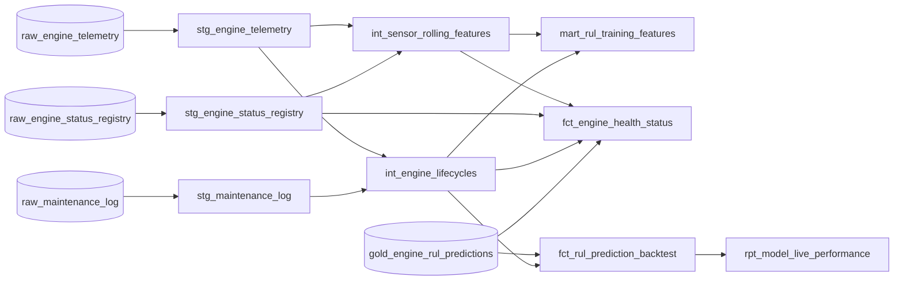

# Architecture deep dive

How a sensor reading travels from the edge database to a Remaining Useful Life prediction, what
each hop guarantees, and why it is built this way. For the quick tour, start with the
[README](../README.md).

## 1. The journey of one telemetry pulse

| # | Hop | What happens | Typical latency |
|---|---|---|---|
| 1 | Simulator → Postgres | each engine INSERTs one pulse per second into `engine_telemetry` (one transaction per tick for the whole fleet) | – |
| 2 | Postgres → Debezium | the `pgoutput` logical decoding plugin streams the committed change from the WAL through the replication slot `dbz_engine_slot` | < 1 s |
| 3 | Debezium → Kafka | the change becomes a JSON envelope (`before`, `after`, `source`, `op`, `ts_ms`) on `engine_cdc.public.engine_telemetry`, keyed by the primary key | < 1 s |
| 4 | Kafka → Spark (Path B) | one `foreachBatch` query, triggered every 5 s, parses all three topics and inserts into ClickHouse `raw_*` tables | p50 4.2 s, p95 6.3 s commit → ClickHouse |
| 5 | Kafka → Spark (Path A) | six exactly-once file sinks write bronze (raw records) and silver (typed images) Parquet to MinIO every 60 s | ≤ 60 s |
| 6 | ClickHouse → dbt | the orchestrator runs `dbt run` + `dbt test` every 2 min: dedup, rolling features, gold marts | ≤ 2 min |
| 7 | dbt → model | the production model scores the newest feature row of every engine after each dbt cycle | seconds |

## 2. CDC event semantics

The simulator is designed so that every Debezium operation type appears in the stream:

| Simulator statement | Table | Debezium `op` |
|---|---|---|
| Register a new engine | `engine_status_registry` | `c` |
| Telemetry pulse | `engine_telemetry` | `c` |
| Progress per cycle, status change (HEALTHY → WARNING → CRITICAL → FAILURE) | `engine_status_registry` | `u` |
| Failure: open a work order | `maintenance_log` | `c`, then `u` (`warning_rows_flagged`) |
| Failure: back-flag the WARNING/CRITICAL/FAILURE rows of the lifecycle with the `maintenance_id` | `engine_telemetry` | `u` (~25 % of a lifecycle's rows) |
| Repair finished: close the work order | `maintenance_log` | `u` |
| Repair finished: `MAINTENANCE_RESET`, new lifecycle, wear back to 0 | `engine_status_registry` | `u` |
| Rows that existed before the connector was registered (initial snapshot) | all | `r` |

`REPLICA IDENTITY FULL` on all three tables makes UPDATE and DELETE events carry the complete
before-image. The publication `dbz_engine_publication` is created in
[`init.sql`](../infrastructure/postgres/init.sql), so the connector never needs table ownership.
Credentials and the topic prefix reach the connector through Kafka Connect's
`EnvVarConfigProvider` (`${env:POSTGRES_PASSWORD}`), so the connector JSON contains no secrets.

## 3. Streaming topology

The Spark job ([`streaming/`](../streaming)) runs seven independent queries in one driver, each with
its own checkpoint under `/opt/spark-checkpoints/<query>`:

| Query | Source | Sink | Trigger | Guarantee |
|---|---|---|---|---|
| `bronze_<table>` × 3 | one topic each | `s3a://lakehouse/bronze/<table>/ingest_date=…` | 60 s | exactly-once for Spark readers of the table root (`_spark_metadata`); other readers dedup by `(kafka_topic, kafka_partition, kafka_offset)` |
| `silver_<table>` × 3 | one topic each | `s3a://lakehouse/silver/<table>/event_date=…` | 60 s | exactly-once for Spark readers; other readers dedup by primary key, highest `cdc_lsn` |
| `clickhouse_raw` | all three topics | `raw_engine_telemetry`, `raw_engine_status_registry`, `raw_maintenance_log` | 5 s | at-least-once + idempotent tables |

A supervisor inside the driver keeps the two paths independent. The lake queries start as soon as
Kafka and MinIO answer; `clickhouse_raw` starts once Kafka and ClickHouse (with its tables)
answer. A failing query is restarted from its own checkpoint with backoff (2 s up to 60 s) while
the others keep running, and the process exits only on invalid configuration, SIGTERM or a dead
driver. The supervisor rewrites `/tmp/streaming.heartbeat` (per-query state, last progress, last
error) every few seconds; the container healthcheck turns unhealthy when it goes stale.

CDC queries run with `failOnDataLoss=true` (`KAFKA_FAIL_ON_DATA_LOSS`): if the job was down for
longer than the Kafka retention, a query stops loudly at the gap instead of silently skipping
change events.

**Parsing rules** (shared by silver and ClickHouse): the record is the `after` image for `c`/`u`/`r`
and the `before` image for `d` (stored with `is_deleted = 1`); `cdc_lsn` is the Postgres log
sequence number from `source.lsn`, which orders every version of a row. Timestamps are converted
from exact unix microseconds, so they land in ClickHouse to the microsecond regardless of the
process time zone. Malformed or impossible records (bad JSON, missing images, out-of-range
timestamps, negative unsigned values) go to `raw_cdc_dead_letter` with a reason instead of
crash-looping the job on every replay.

## 4. Storage layout

### Lakehouse (MinIO, bucket `lakehouse`)

```text
lakehouse/
├── bronze/<table>/ingest_date=YYYY-MM-DD/part-*.parquet       raw Kafka records, verbatim (non-Spark readers: dedup by topic/partition/offset)
├── silver/<table>/event_date=YYYY-MM-DD/part-*.parquet        typed images, append-only (non-Spark readers: dedup by key, max cdc_lsn)
├── silver/int_sensor_rolling_features/snapshot_ts=<TS>/data.parquet
├── gold/mart_rul_training_features/snapshot_ts=<TS>/data.parquet
├── gold/fct_engine_health_status/snapshot_ts=<TS>/data.parquet
└── ml-artifacts/rul_model/
    ├── rul-<TS>/{model_bundle.joblib, regressor.json, metadata.json, metrics.json, feature_importance.csv}
    └── production.json                                         pointer to the promoted version
```

`<table>` is `engine_telemetry`, `engine_status_registry` or `maintenance_log`; `<TS>` is
`YYYYMMDDTHHMMSSZ` (UTC). Snapshots are exported by the orchestrator and pruned to the newest
`SNAPSHOT_RETENTION`.

### ClickHouse (database `iot_engine`)

| Layer | Object | Written by | Engine | Purpose |
|---|---|---|---|---|
| raw | `raw_engine_telemetry` | Spark | `ReplacingMergeTree(cdc_lsn)` | latest image per `telemetry_id` |
| raw | `raw_engine_status_registry` | Spark | `ReplacingMergeTree`, key `(engine_id, cdc_lsn)` | full status history |
| raw | `raw_maintenance_log` | Spark | `ReplacingMergeTree(cdc_lsn)` | latest image per work order |
| raw | `raw_cdc_dead_letter` | Spark | `MergeTree`, 30-day TTL | unparseable CDC records |
| silver | `stg_engine_telemetry` | dbt, incremental | `ReplacingMergeTree(cdc_lsn, is_deleted)` | deduplicated pulses, late-data lookback |
| silver | `stg_engine_status_registry` | dbt, incremental | `ReplacingMergeTree` | status history |
| silver | `stg_maintenance_log` | dbt, table | `ReplacingMergeTree` | one row per work order |
| silver | `int_engine_lifecycles` | dbt, table | `ReplacingMergeTree` | one row per engine lifecycle, failure cycle and mode |
| silver | `int_sensor_rolling_features` | dbt, incremental | `ReplacingMergeTree(feature_computed_at, is_deleted)` | 46 point-in-time ML features per pulse |
| gold | `mart_rul_training_features` | dbt, table | `ReplacingMergeTree` | features + RUL labels of completed lifecycles |
| gold | `fct_engine_health_status` | dbt, table | `ReplacingMergeTree` | one row per engine: state, KPIs, calibrated anomaly flags, latest prediction aged to the current cycle |
| gold | `fct_rul_prediction_backtest` | dbt, table | `ReplacingMergeTree` | first scoring of every pre-failure pulse of a failed lifecycle, scored against the truth |
| gold | `rpt_model_live_performance` | dbt, table | `ReplacingMergeTree` | live RMSE, MAE, bias, NASA score, horizon precision/recall/F1 and warning lead time per model version |
| serving | `gold_engine_rul_predictions` | `predict_rul.py` | `MergeTree`, 180-day TTL | every prediction with its sensor readings |
| serving | `ml_model_runs` | `train_rul_model.py` | `MergeTree` | training-run registry |
| serving | `v_engine_rul_latest` | view | – | latest prediction per engine |



## 5. Correctness and idempotency, end to end

- **Replays are harmless.** Spark may replay a micro-batch after a crash. ClickHouse tables are
  keyed by the source primary key and versioned by `cdc_lsn`, so a replayed row collapses into the
  same version, and every dbt model reads with `FINAL` or explicit `argMax(..., cdc_lsn)`.
- **Updates win by log position, not arrival time.** The back-flagging UPDATE of a telemetry row
  carries a higher `cdc_lsn` than its INSERT, so the flagged version wins in `raw_*`, `stg_*` and
  the silver lake (readers keep the row with the highest `cdc_lsn` per key).
- **Late data is recomputed, not appended.** `stg_engine_telemetry` re-reads a 10-minute
  ingestion-time lookback. `int_sensor_rolling_features` recomputes every engine lifecycle that
  received a new or corrected pulse, because one late pulse shifts the windows of its neighbours.
  The integration harness proves the incremental result equals a `--full-refresh`. Every feature
  row also records the `baseline_cycles` it was computed with, so changing that variable
  recomputes every lifecycle on the next run (`assert_features_use_current_baseline_cycles` fails
  until it has).
- **No future leakage.** Every feature uses only rows at or before its own `event_ts`: backward
  time windows, lag-1 deltas and an *expanding* lifecycle baseline.

## 6. Failure and restart behaviour

| Event | Behaviour |
|---|---|
| `docker compose down` → `up` | everything resumes within the 7-day Kafka retention: Debezium from its stored offsets, Spark from its checkpoints, the simulator from the registry and the generation settings it stores per lifecycle in `simulator_lifecycle_params` (bit-identical wear trajectory; changed `SIM_SEED` / `SIM_MEAN_LIFE_CYCLES` / `SIM_PULSES_PER_CYCLE` apply from each engine's next lifecycle) |
| ClickHouse down | `clickhouse_raw` fails after its insert retries and is restarted from its checkpoint (backoff 2–60 s) once ClickHouse answers; the six lake queries keep committing; the process stays up |
| MinIO down | the lake queries stall or fail and resume from their checkpoints once MinIO answers; `clickhouse_raw` keeps running |
| Outage longer than the Kafka retention | queries whose unread records were deleted stop loudly (`KAFKA_FAIL_ON_DATA_LOSS=true`) with recovery steps in the log |
| Postgres down | the simulator drops ticks with bounded reconnect backoff and re-takes its single-writer lock on reconnect; after 10 failed attempts it exits and Docker restarts it |
| A second simulator against the same database | refused: every session takes the advisory lock `jet-engine-simulator`; the newcomer waits up to 60 s, then exits 2 while the first keeps writing |
| Simulator killed during the first-boot backfill | each engine's history is one transaction; the next start backfills exactly the engines that still have no telemetry |
| A task fails in the orchestrator | logged as FAILED with its output tail; the loop continues; repeated failures back off exponentially; a failed dbt test skips that cycle's training and snapshot |
| A manual `make` job while the loop runs the same job | it waits for the per-job lock (shared volume) instead of colliding |
| Debezium connector stopped, PAUSED or FAILED | the replication slot retains WAL (capped by `max_slot_wal_keep_size`, 4 GB); `make register-cdc` restarts or resumes it; `make cdc-status` exits 1 until it is RUNNING |
| Driver loop of the streaming job wedged | `/tmp/streaming.heartbeat` goes stale and the container turns unhealthy |
| `make clean` | all volumes are deleted; the next `make up` rebuilds history from the backfill |

## 7. Design decisions

| Decision | Why | Trade-off |
|---|---|---|
| Log-based CDC (Debezium) instead of polling | captures every UPDATE, preserves order, no load from repeated scans | needs `wal_level=logical` and a slot that must be monitored |
| Two sinks with separate checkpoints | the lake stays exactly-once and independent of OLAP availability | the same topic is read twice |
| ReplacingMergeTree + `cdc_lsn` | makes at-least-once delivery idempotent without a transactional sink | readers must use `FINAL` or `argMax` |
| Incremental dbt by touched lifecycle | rolling windows stay correct under late data at a fraction of a full rebuild | recomputes whole lifecycles (~1 800 rows) per touched engine |
| Features in dbt, not in Python | one definition serves training, inference and BI, which removes train/serve skew | windowed SQL is harder to unit test (hence the integration harness) |
| Lightweight scheduler instead of Airflow | one small container, zero extra infrastructure for a single-node stack | no UI or backfill semantics; the same tasks map one to one onto Airflow operators |
| Community MinIO build (`pgsty/minio`) | the official images are no longer published | pinned by digest; override with `MINIO_IMAGE` |
| Ports bound to `127.0.0.1` by default | default credentials stay unreachable from the network | set `BIND_HOST` to expose the stack deliberately |
