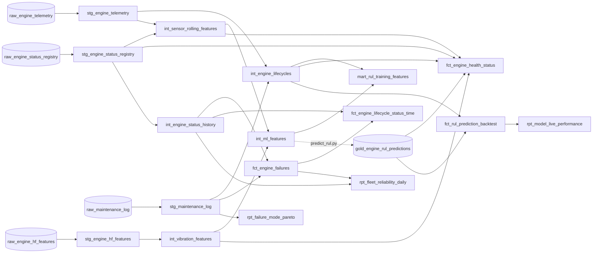

# Architecture deep dive

How a sensor reading travels from the edge database to a Remaining Useful Life prediction, what
each hop guarantees, and why it is built this way. For the quick tour, start with the
[README](../README.md).

## 1. The journey of one telemetry pulse

| # | Hop | What happens | Typical latency |
|---|---|---|---|
| 1 | Simulator → Postgres | each engine INSERTs one pulse per second into `engine_telemetry` (one transaction per tick for the whole fleet) | – |
| 2 | Postgres → Debezium | the `pgoutput` logical decoding plugin streams the committed change from the WAL through the replication slot `dbz_engine_slot` | < 1 s |
| 3 | Debezium → Kafka | the change becomes a JSON envelope (`before`, `after`, `source`, `op`, `ts_ms`) on `engine_cdc.public.engine_telemetry`, keyed by the primary key | < 1 s |
| 4 | Kafka → Spark (Path B) | one `foreachBatch` query, triggered every 5 s, parses all three topics and inserts into ClickHouse `raw_*` tables | p50 4.2 s, p95 6.3 s commit → ClickHouse |
| 5 | Kafka → Spark (Path A) | six exactly-once file sinks write bronze (raw records) and silver (typed images) Parquet to MinIO every 60 s | ≤ 60 s |
| 6 | ClickHouse → dbt | the orchestrator runs `dbt run` + `dbt test` every 2 min: dedup, rolling features, gold marts | ≤ 2 min |
| 7 | dbt → model | the production model scores the newest feature row of every engine after each dbt cycle | seconds |

### The journey of one high-frequency (HF) sensor frame

Next to every pulse the simulator produces a full-fidelity sensor frame: the vibration waveforms
and the process channels of the same second. It never touches Postgres; the frame goes straight
to Kafka, and the platform reduces it to features on the way in.

| # | Hop | What happens | Bound |
|---|---|---|---|
| 1 | Simulator → Kafka | after the tick's Postgres transaction commits, a background publisher thread serializes one frame per operating engine (Confluent wire format: magic byte, schema id, Avro with packed little-endian float32 samples) and produces it zstd-compressed to `engine_hf.sensor_frames`, keyed by `engine_id`; the frame carries the pulse's `telemetry_id` | < 1 s |
| 2 | Kafka → Spark (lake) | `bronze_engine_sensor_frames` writes the raw record bytes; `silver_engine_hf_features` decodes them (`from_avro`) and computes the per-frame features (`mapInPandas`, Hann-windowed FFT) | 60 s trigger |
| 3 | Kafka → Spark (ClickHouse) | `clickhouse_hf_features` decodes, computes the same features and inserts them into `raw_engine_hf_features`, plus one throughput row per micro-batch into `hf_ingest_batches` | 10 s trigger |
| 4 | ClickHouse → dbt | `stg_engine_hf_features` → `int_vibration_features` (5-minute rolling means) → `int_ml_features`, the view that joins them onto the pulse features by `telemetry_id` | ≤ 2 min |
| 5 | dbt → model | the newest pulse is scored with its spectral features; a pulse whose frame has not landed yet takes them from the newest landed frame of its lifecycle within `SPECTRAL_MAX_LAG_SECONDS` | seconds |

## 2. CDC event semantics

The simulator is designed so that every Debezium operation type appears in the stream:

| Simulator statement | Table | Debezium `op` |
|---|---|---|
| Register a new engine | `engine_status_registry` | `c` |
| Telemetry pulse | `engine_telemetry` | `c` |
| Progress per cycle, status change (HEALTHY → WARNING → CRITICAL → FAILURE) | `engine_status_registry` | `u` |
| Failure: open a work order | `maintenance_log` | `c`, then `u` (`warning_rows_flagged`) |
| Failure: back-flag the WARNING/CRITICAL/FAILURE rows of the lifecycle with the `maintenance_id` | `engine_telemetry` | `u` (~25 % of a lifecycle's rows) |
| Repair finished: close the work order | `maintenance_log` | `u` |
| Repair finished: `MAINTENANCE_RESET`, new lifecycle, wear back to 0 | `engine_status_registry` | `u` |
| Rows that existed before the connector was registered (initial snapshot) | all | `r` |

`REPLICA IDENTITY FULL` on all three tables makes UPDATE and DELETE events carry the complete
before-image. The publication `dbz_engine_publication` is created in
[`init.sql`](../infrastructure/postgres/init.sql), and the connector uses it as it is
(`publication.autocreate.mode=disabled`; Debezium's `filtered` mode runs `ALTER PUBLICATION` on
every start, which only the publication's owner may do). So the connector streams as `debezium`, a
role with LOGIN, REPLICATION and SELECT on the three tables, which the one-shot `postgres-init` job
([`roles.sql`](../infrastructure/postgres/roles.sql)) creates or updates on every `up`; a table
added to `table.include.list` must also join the publication and that grant. PostgreSQL cannot
narrow REPLICATION to a publication, so the role could still decode every table's changes through a
slot of its own: its password guards the whole change stream. The role's credentials and the topic
prefix reach the connector through Kafka Connect's `EnvVarConfigProvider`
(`${env:POSTGRES_CDC_PASSWORD}`), so the connector JSON contains no secrets and the worker never
holds the superuser's password.

## 3. Streaming topology

The Spark job ([`streaming/`](../streaming)) runs ten independent queries in one driver, seven on
the CDC topics and three on the HF frame topic, each with its own checkpoint under
`/opt/spark-checkpoints/<query>`:

| Query | Source | Sink | Trigger | Guarantee |
|---|---|---|---|---|
| `bronze_<table>` × 3 | one topic each | `s3a://lakehouse/bronze/<table>/ingest_date=…` | 60 s | exactly-once for Spark readers of the table root (`_spark_metadata`); other readers dedup by `(kafka_topic, kafka_partition, kafka_offset)` |
| `silver_<table>` × 3 | one topic each | `s3a://lakehouse/silver/<table>/event_date=…` | 60 s | exactly-once for Spark readers; other readers dedup by primary key, highest `cdc_lsn` |
| `clickhouse_raw` | all three topics | `raw_engine_telemetry`, `raw_engine_status_registry`, `raw_maintenance_log` | 5 s | at-least-once + idempotent tables |
| `bronze_engine_sensor_frames` | `engine_hf.sensor_frames` | `s3a://lakehouse/bronze/engine_sensor_frames/ingest_date=…/ingest_hour=…` | 60 s | exactly-once for Spark readers; other readers dedup by `(kafka_partition, kafka_offset)`; objects expire after `HF_BRONZE_RETENTION_DAYS` |
| `silver_engine_hf_features` | `engine_hf.sensor_frames` | `s3a://lakehouse/silver/engine_hf_features/event_date=…` | 60 s | exactly-once for Spark readers; other readers dedup by `(engine_id, telemetry_id)` |
| `clickhouse_hf_features` | `engine_hf.sensor_frames` | `raw_engine_hf_features`, `hf_ingest_batches` | 10 s | at-least-once + idempotent table |

A supervisor inside the driver keeps the two paths independent. The lake queries start as soon as
Kafka and MinIO answer; `clickhouse_raw` starts once Kafka and ClickHouse (with its tables)
answer. A failing query is restarted from its own checkpoint with backoff (2 s doubling up to 60 s, each
wait jittered between half and all of its step so that queries failed by one outage do not all
restart in the same round) while the others keep running, and the process exits only on invalid configuration, SIGTERM or a dead
driver. The supervisor rewrites `/tmp/streaming.heartbeat` (per-query state, last progress, last
error) every few seconds; the container healthcheck turns unhealthy when it goes stale. Each HF
query also checks its own prerequisites (the Avro schema file, the HF ClickHouse tables), so a
missing one keeps only that query retrying.

**Progress of every micro-batch.** A `StreamingQueryListener` (`ProgressRecorder` in
[`streaming_queries.py`](../streaming/streaming_queries.py)) turns the `StreamingQueryProgress`
Spark reports for every micro-batch of the ten queries into one row of `ops_stream_progress`; an
idle trigger reports a `QueryIdleEvent` and writes none. The row holds the query name, run id and
batch id, the trigger's start (UTC, milliseconds), input rows, input and processed rows per second,
the batch duration (`triggerExecution`) with its sink (`addBatch`) and Kafka offset lookup
(`latestOffset`) phases, and the consumer lag: the newest offset minus the batch's end offset,
summed over every partition of the query's topics, NULL for a batch re-run from the offset log
after a failure (it looks up no newest offsets). The listener only appends to a bounded buffer
(1,000 rows, [`streaming_progress.py`](../streaming/streaming_progress.py)); a thread of its own
inserts it every 10 s through Path B's ClickHouse writer and its retries, and the job flushes once
more after `spark.stop()` has delivered the last events. Rows ClickHouse cannot take are dropped and
counted in the log; so is the oldest row of a full buffer, whose count is logged with the next
failed flush. Monitoring data never blocks or fails a query.

CDC queries run with `failOnDataLoss=true` (`KAFKA_FAIL_ON_DATA_LOSS`): if the job was down for
longer than the Kafka retention, a query stops loudly at the gap instead of silently skipping
change events. The HF path is best effort by design (`HF_FAIL_ON_DATA_LOSS=false`): frames the
2-hour topic retention deleted before a query read them are skipped with a warning, because the
1 Hz pulse in Postgres stays the system of record.

**HF decoding and features.** A record must start with the magic byte 0; the 5-byte header is
stripped and `from_avro` decodes the rest with the schema file
[`engine_sensor_frame.avsc`](../infrastructure/schemas/engine_sensor_frame.avsc), the same file
the producer registered under the subject `engine_hf.sensor_frames-value` (compatibility
BACKWARD). The samples travel as packed float32 bytes, so serialization costs next to nothing at
kHz rates. `mapInPandas` reduces the fan and core vibration channels to RMS, peak, crest factor,
kurtosis and a Hann-windowed spectrum (1×N1, 1×N2 and bearing-defect BPFO tone amplitudes,
high-band energy share, spectral centroid), and the ~80 process channels to per-frame means.
Frames that cannot be decoded land in `raw_cdc_dead_letter` with the reason. A micro-batch reads
at most `HF_MAX_OFFSETS_PER_TRIGGER` frames, so a backlog (the first-boot backfill) is worked off
in bounded batches.

**Parsing rules** (shared by silver and ClickHouse): the record is the `after` image for `c`/`u`/`r`
and the `before` image for `d` (stored with `is_deleted = 1`); `cdc_lsn` is the Postgres log
sequence number from `source.lsn`, which orders every version of a row. Timestamps are converted
from exact unix microseconds, so they land in ClickHouse to the microsecond regardless of the
process time zone. Malformed or impossible records (bad JSON, missing images, out-of-range
timestamps, negative unsigned values) go to `raw_cdc_dead_letter` with a reason instead of
crash-looping the job on every replay.

## 4. Storage layout

### Lakehouse (MinIO, bucket `lakehouse`)

```text
lakehouse/
├── bronze/<table>/ingest_date=YYYY-MM-DD/part-*.parquet       raw Kafka records, verbatim (non-Spark readers: dedup by topic/partition/offset)
├── bronze/engine_sensor_frames/ingest_date=YYYY-MM-DD/ingest_hour=H/part-*.parquet
│                                                               raw Avro frames (Kafka value bytes), expired after HF_BRONZE_RETENTION_DAYS
├── silver/<table>/event_date=YYYY-MM-DD/part-*.parquet        typed images, append-only (non-Spark readers: dedup by key, max cdc_lsn)
├── silver/engine_hf_features/event_date=YYYY-MM-DD/part-*.parquet
│                                                               per-frame vibration and process features (~2 % of the frame bytes)
├── silver/int_ml_features/snapshot_ts=<TS>/data.parquet       ML feature vector (pulse + spectral), last 7 days
├── gold/mart_rul_training_features/snapshot_ts=<TS>/data.parquet
├── gold/fct_engine_health_status/snapshot_ts=<TS>/data.parquet
└── ml-artifacts/rul_model/
    ├── rul-<TS>/{model_bundle.joblib, regressor.json, metadata.json, metrics.json, feature_importance.csv}
    └── production.json                                         pointer to the promoted version
```

`<table>` is `engine_telemetry`, `engine_status_registry` or `maintenance_log`; `<TS>` is
`YYYYMMDDTHHMMSSZ` (UTC). Snapshots are exported by the orchestrator and pruned to the newest
`SNAPSHOT_RETENTION`. The raw frames are the only data that expire: a MinIO lifecycle rule
(created by `minio-init`) deletes `bronze/engine_sensor_frames/ingest_date=…` objects after
`HF_BRONZE_RETENTION_DAYS` (at the first midnight after that age), and the bronze sink forgets
files older than that minus an hour at its compaction batches (every 10 micro-batches), so the
log does not grow without bound. Compaction only runs while frames arrive: after an idle period
the log can still list expired objects, so Spark readers of the bronze root set
`spark.sql.files.ignoreMissingFiles=true`. The rule's prefix spares `_spark_metadata` itself,
whose loss would stop the query on its next restart.

### ClickHouse (database `iot_engine`)

| Layer | Object | Written by | Engine | Purpose |
|---|---|---|---|---|
| raw | `raw_engine_telemetry` | Spark | `ReplacingMergeTree(cdc_lsn)` | latest image per `telemetry_id` |
| raw | `raw_engine_status_registry` | Spark | `ReplacingMergeTree`, key `(engine_id, cdc_lsn)` | full status history |
| raw | `raw_maintenance_log` | Spark | `ReplacingMergeTree(cdc_lsn)` | latest image per work order |
| raw | `raw_cdc_dead_letter` | Spark | `MergeTree`, 30-day TTL | unparseable CDC records and HF frames |
| raw | `raw_engine_hf_features` | Spark | `ReplacingMergeTree(ingested_at)`, key `(engine_id, telemetry_id)`, 90-day TTL | vibration and process features of every HF frame |
| raw | `hf_ingest_batches` | Spark | `MergeTree`, 30-day TTL | one row per HF micro-batch: frames, bytes, engines, frame-time span |
| silver | `stg_engine_telemetry` | dbt, incremental | `ReplacingMergeTree(cdc_lsn, is_deleted)` | deduplicated pulses, late-data lookback |
| silver | `stg_engine_status_registry` | dbt, incremental | `ReplacingMergeTree` | status history |
| silver | `stg_maintenance_log` | dbt, table | `ReplacingMergeTree` | one row per work order |
| silver | `stg_engine_hf_features` | dbt, incremental | `ReplacingMergeTree(ingested_at)` | deduplicated HF frame features |
| silver | `int_engine_lifecycles` | dbt, table | `ReplacingMergeTree` | one row per engine lifecycle, failure cycle and mode |
| silver | `int_sensor_rolling_features` | dbt, incremental | `ReplacingMergeTree(feature_computed_at, is_deleted)` | 46 point-in-time ML features per pulse |
| silver | `int_vibration_features` | dbt, incremental | `ReplacingMergeTree(feature_computed_at, is_deleted)` | 10 spectral ML features per frame: 5-minute rolling means of the bearing, unbalance and oil-system evidence |
| silver | `int_ml_features` | dbt, view | – | the ML feature vector of every pulse (46 pulse + 10 spectral features); training and scoring both read it |
| gold | `mart_rul_training_features` | dbt, table | `ReplacingMergeTree` | features + RUL labels of completed lifecycles |
| gold | `fct_engine_health_status` | dbt, table | `ReplacingMergeTree` | one row per engine: state, KPIs, calibrated anomaly flags, latest prediction aged to the current cycle |
| gold | `fct_rul_prediction_backtest` | dbt, table | `ReplacingMergeTree` | first scoring of every pre-failure pulse of a failed lifecycle, scored against the truth |
| silver | `int_engine_status_history` | dbt, table | `ReplacingMergeTree`, key `(engine_id, valid_from)` | SCD Type 2 status history: one row per engine and status interval, rebuilt from the registry's CDC log every run |
| gold | `fct_engine_failures` | dbt, table | `ReplacingMergeTree` | one row per failure: time to repair, time and cycles in service since the previous return to service, failure mode |
| gold | `fct_engine_lifecycle_status_time` | dbt, table | `ReplacingMergeTree` | time in each status per engine lifecycle, availability, failures |
| gold | `rpt_fleet_reliability_daily` | dbt, table | `ReplacingMergeTree` | availability, failures, MTBF (time and cycles), MTTR per UTC day and engine, plus the fleet (`ALL`) |
| gold | `rpt_failure_mode_pareto` | dbt, table | `ReplacingMergeTree` | work orders per failure mode, ranked with cumulative shares, per engine and fleet |
| gold | `rpt_model_live_performance` | dbt, table | `ReplacingMergeTree` | live RMSE, MAE, bias, NASA score, horizon precision/recall/F1 and warning lead time per model version |
| serving | `gold_engine_rul_predictions` | `predict_rul.py` | `MergeTree`, 180-day TTL, insert deduplication window 100 | every prediction with its sensor readings |
| serving | `ml_model_runs` | `train_rul_model.py` | `MergeTree`, insert deduplication window 100 | training-run registry |
| serving | `v_engine_rul_latest` | view | – | latest prediction per engine |
| ops | `ops_reconciliation` | `reconcile_lakehouse.py` | `MergeTree`, key `(run_at, layer, engine_id, event_hour)`, 30-day TTL, insert deduplication window 100 | one row per reconciliation run, layer, engine and hour of event time: source pulses the layer must hold, pulses it holds, OK / MISSING / EXTRA |
| ops | `ops_stream_progress` | Spark (listener of the streaming job) | `MergeTree`, key `(query_name, trigger_ts)`, 30-day TTL | one row per micro-batch of every streaming query: input rows and rates, durations of the batch, its sink and its Kafka offset lookup, Kafka consumer lag in records (NULL for a re-run batch) |



## 5. Correctness and idempotency, end to end

- **Replays are harmless.** Spark may replay a micro-batch after a crash. ClickHouse tables are
  keyed by the source primary key and versioned by `cdc_lsn`, so a replayed row collapses into the
  same version, and every dbt model reads with `FINAL` or explicit `argMax(..., cdc_lsn)`.
- **A retried insert lands once.** The data-science jobs append predictions, training runs and
  audit cells through one ClickHouse gateway, which retries an insert after a read timeout or a
  dropped connection, failures that can come after ClickHouse stored the batch. Every attempt of one
  insert carries the same `insert_deduplication_token`, and the three tables keep the block IDs of
  their last 100 inserts (`non_replicated_deduplication_window`), so the retried copy is dropped;
  the next insert gets a new token and lands even when its rows are identical.
- **Updates win by log position, not arrival time.** The back-flagging UPDATE of a telemetry row
  carries a higher `cdc_lsn` than its INSERT, so the flagged version wins in `raw_*`, `stg_*` and
  the silver lake (readers keep the row with the highest `cdc_lsn` per key).
- **Late data is recomputed, not appended.** `stg_engine_telemetry` re-reads a 10-minute
  ingestion-time lookback. `int_sensor_rolling_features` recomputes every engine lifecycle that
  received a new or corrected pulse, because one late pulse shifts the windows of its neighbours.
  The integration harness proves the incremental result equals a `--full-refresh`. Every feature
  row also records the `baseline_cycles` it was computed with, so changing that variable
  recomputes every lifecycle on the next run (`assert_features_use_current_baseline_cycles` fails
  until it has).
- **No future leakage.** Every feature uses only rows at or before its own `event_ts`: backward
  time windows, lag-1 deltas and an *expanding* lifecycle baseline.
- **HF frames join their pulse exactly.** The simulator inserts the pulse with
  `INSERT … RETURNING telemetry_id` and puts that key into the frame, so frame and pulse are
  matched by primary key, never by a time window. `raw_engine_hf_features` is keyed by
  `(engine_id, telemetry_id)` with `ingested_at` as the version, so a replayed micro-batch
  collapses into one row and raw and staging keep the same copy. `int_vibration_features`
  recomputes the lifecycles that received frames, like the pulse features, and a dbt test
  proves that `int_ml_features` carries exactly the rows of `int_sensor_rolling_features`.
  Each frame's noise is keyed by `SIM_SEED` and its `telemetry_id`, so a frame rebuilt by a resumed
  backfill is byte-identical to the original and either copy yields the same feature row.
- **The status history is rebuilt from the change log.** `int_engine_status_history` orders the
  registry's versions by `cdc_lsn` (replays and late versions change nothing), closes an interval at
  a delete and makes the event time monotonic per engine, so history backfilled behind a
  registration tiles correctly; dbt tests prove that intervals never overlap and tile time, and that
  the open interval is the registry's current state. Staging keeps the first copy of a replayed
  version, the one an incremental run published, so a full refresh reproduces `stg_*` exactly.

- **Every layer is reconciled against the source.** Every `RECONCILE_INTERVAL_SECONDS` the
  orchestrator task `reconcile` (`data_science/reconcile_lakehouse.py`) counts in one ClickHouse
  query, per engine and hour of event time, the last 6 hours of pulses in four places: PostgreSQL
  (`postgresql()` as the SELECT-only role `auditor`, the window pushed down),
  `raw_engine_telemetry FINAL`, `stg_engine_telemetry FINAL`
  and the silver Parquet (`s3()`, newest image per `telemetry_id`), and records OK / MISSING / EXTRA
  per cell in `ops_reconciliation`. Every layer applies the same filter, event time inside the window
  and the source's insert time at least `RECONCILE_LAG_SECONDS` before the run, so in-flight data is
  never a false alarm; staging is held to the pulses with finite readings, the ones it keeps by
  design; HF frame coverage is reported but never fails the audit.

## 6. Failure and restart behaviour

| Event | Behaviour |
|---|---|
| `docker compose down` → `up` | everything resumes within the 7-day Kafka retention: Debezium from its stored offsets, Spark from its checkpoints, the simulator from the registry and the generation settings it stores per lifecycle in `simulator_lifecycle_params`, plus the HF frames a backfilled history still owes from `simulator_hf_backfill` (bit-identical wear trajectory; changed `SIM_SEED` / `SIM_MEAN_LIFE_CYCLES` / `SIM_PULSES_PER_CYCLE` apply from each engine's next lifecycle) |
| ClickHouse down | `clickhouse_raw` fails after its insert retries and is restarted from its checkpoint (jittered backoff of at most 2–60 s) once ClickHouse answers; the six lake queries keep committing; a progress flush that still fails after the insert retries drops its rows and logs the count, while the rows reported meanwhile wait in the buffer (a 30 s outage cost 2 of 59 rows in a test); the process stays up |
| MinIO down | the lake queries stall or fail and resume from their checkpoints once MinIO answers; `clickhouse_raw` keeps running |
| Outage longer than the Kafka retention | queries whose unread records were deleted stop loudly (`KAFKA_FAIL_ON_DATA_LOSS=true`) with recovery steps in the log |
| Postgres down | the simulator drops ticks with bounded reconnect backoff and re-takes its single-writer lock on reconnect; after 10 failed attempts it exits and Docker restarts it |
| A second simulator against the same database | refused: every session takes the advisory lock `jet-engine-simulator`; the newcomer waits up to 60 s, then exits 2 while the first keeps writing |
| Simulator killed during the first-boot backfill | each engine's history is one transaction; the next start backfills exactly the engines that still have no telemetry; the engine's HF backfill row commits in the same transaction |
| A task fails in the orchestrator | logged as FAILED with its output tail; the loop continues; repeated failures back off exponentially; a failed dbt test skips that cycle's training and snapshot |
| A manual `make` job while the loop runs the same job | it waits for the per-job lock (shared volume) instead of colliding |
| Debezium connector stopped, PAUSED or FAILED | the replication slot retains WAL (capped by `max_slot_wal_keep_size`, 4 GB); `make register-cdc` restarts or resumes it; `make cdc-status` exits 1 until it is RUNNING |
| `postgres-init` fails (a wrong superuser password in `.env`, a role variable naming the superuser or the other role) | Debezium and the orchestrator do not start, because they log in with the roles it maintains; services already running keep running; `make logs SERVICE=postgres-init` names the error and the next `make up` retries |
| Driver loop of the streaming job wedged | `/tmp/streaming.heartbeat` goes stale and the container turns unhealthy |
| Kafka slow or down for the HF producer | frames are produced from a background thread, so the 1 Hz Postgres tick never waits; frames wait in a buffer of `SIM_HF_QUEUE_MAX_MB` that holds both queued and unacknowledged frames; the producer has no delivery timeout, so the buffer bounds an outage (about 37 minutes of the default fleet's frames), after which new frames are dropped and counted |
| Simulator stopped before the first-boot HF backlog reached Kafka (`make down`, a crash, Kafka never up) | each engine's history transaction also writes its row in `simulator_hf_backfill` (frames owed, last event time); the row is deleted only after Kafka has acknowledged every backfill frame of that engine. The next start rebuilds the owed frames from the stored pulses and `simulator_lifecycle_params` (same `telemetry_id`, `frame_seq` and physics; byte-identical under an unchanged `SIM_SEED`) and queues them as backfill again, while live frames keep flowing; frames sent twice collapse in `raw_engine_hf_features`. A history the recorded settings cannot reproduce is logged and its row dropped |
| ClickHouse volume lost, a raw table dropped or truncated, rows deleted by mistake | `make ch-init` (or a ClickHouse restart) recreates the schema and the streaming job resumes with new changes; `make restore-raw` rebuilds the history of every raw table from the silver lake (only the rows raw lacks, so it is safe on a live stack and idempotent) and reconciles the restored range; the next dbt run publishes the restored rows |
| The reconciliation finds a layer that disagrees with the source | task `reconcile` exits 65, is logged as FAILED with the worst (layer, engine, hour) cells and backs off; every cell is in `ops_reconciliation`, on the Data Platform dashboard and in `make verify` (WARN) |
| Nothing to reconcile yet (fresh stack, lake or staging not built, `ops_reconciliation` missing) | `reconcile` exits 3 (SKIPPED) and is retried after the next dbt run; on a fresh stack the first comparison follows about `RECONCILE_LAG_SECONDS` after the backfill |
| HF backlog older than the 2-hour topic retention | the HF queries skip the deleted frames with a warning; those pulses keep NULL spectral features, which the models treat as missing |
| HF disabled (`SIM_HF_ENABLED=false`) or lagging | the CDC path, dbt and scoring run unchanged; scoring carries spectral features forward for at most `SPECTRAL_MAX_LAG_SECONDS`, then the models' missing-value branches, fitted by spectral dropout in training, score the pulse from its pulse features; no HF backfill rows are written, and rows left by an earlier run wait for the next start with HF enabled |
| `make clean` | all volumes are deleted; the next `make up` rebuilds history from the backfill |

## 7. Design decisions

| Decision | Why | Trade-off |
|---|---|---|
| Log-based CDC (Debezium) instead of polling | captures every UPDATE, preserves order, no load from repeated scans | needs `wal_level=logical` and a slot that must be monitored |
| Two sinks with separate checkpoints | the lake stays exactly-once and independent of OLAP availability | the same topic is read twice |
| ReplacingMergeTree + `cdc_lsn` | makes at-least-once delivery idempotent without a transactional sink | readers must use `FINAL` or `argMax` |
| Incremental dbt by touched lifecycle | rolling windows stay correct under late data at a fraction of a full rebuild | recomputes whole lifecycles (~1 800 rows) per touched engine |
| Features in dbt, not in Python | one definition serves training, inference and BI, which removes train/serve skew | windowed SQL is harder to unit test (hence the integration harness) |
| HF frames bypass Postgres: Kafka, Avro and Schema Registry | an OLTP database must not absorb kHz waveforms; packed float32 samples keep Avro serialization nearly free, and the registry rejects incompatible schema changes | best effort: frames can be dropped under back-pressure, so the 1 Hz pulse remains the system of record |
| Reduce at ingest, tier the raw | waveforms land once in cheap object storage and expire after a day; only per-frame features (~2 % of the bytes) reach ClickHouse and the model | waveforms older than the retention cannot be reprocessed with new features |
| Lightweight scheduler instead of Airflow | one small container, zero extra infrastructure for a single-node stack | no UI or backfill semantics; the same tasks map one to one onto Airflow operators |
| Community MinIO build (`pgsty/minio`) | the official images are no longer published | pinned by digest; override with `MINIO_IMAGE` |
| Rebuild raw from the silver lake inside ClickHouse (`INSERT ... SELECT ... FROM s3()`, one statement per table and day) | the lake is the system of record: silver holds every raw column but `ingested_at` under the same key and `cdc_lsn`, so a restored row collapses with any copy the streaming job writes; no row passes through Python | `ingested_at` becomes the restore time (lag panels spike once); for an event Debezium delivered twice the restore keeps the later copy where raw may hold the first (only `kafka_offset` and `cdc_emitted_ts` differ); restored HF frames are republished to staging once |
| SCD2 status history derived from the CDC log, rebuilt every run (no dbt snapshot) | the log already holds every version; a rebuild equals a full refresh, and one late or backdated version can move intervals anywhere in an engine's history | reads one registry version per engine and cycle (~52k a day for 6 engines) every dbt cycle |
| One HF backfill row per engine, cleared after every frame of it is acknowledged | a stop or a Kafka outage during the first-boot drain no longer leaves history without spectral features | an interrupted drain re-sends that engine's whole backfill (harmless duplicates) |
| Reconcile inside ClickHouse (`postgresql()`, `s3()` table functions) | one SQL statement compares every layer where the data already lives; nothing new to deploy, and only the window's source rows leave Postgres | ClickHouse must reach Postgres and MinIO by their compose names, and the window reaches Postgres as UTC literals (the database runs with TimeZone UTC, the image default) |
| Progress rows from a listener into a bounded buffer, inserted by a thread of their own and dropped when ClickHouse refuses them | monitoring must never block or fail a micro-batch, and a row ClickHouse rejects must not hold back the rows after it | an outage longer than the insert retries (about 15 s) loses the rows of that flush (counted in the log) |
| Dedicated Postgres roles, re-applied by a one-shot job | Debezium and the audit hold only the privileges they use, and neither container holds the superuser password; init.sql runs once per volume, so only a job that runs on every `up` gives an existing stack the roles and applies a changed password | the connector no longer keeps the publication in step with `table.include.list` (only its owner may alter it): a new CDC table must also join the publication and the role's grant; REPLICATION cannot be narrowed to the publication, so the replication role's password still guards every table's changes |
| Ports bound to `127.0.0.1` by default | default credentials stay unreachable from the network | set `BIND_HOST` to expose the stack deliberately |
