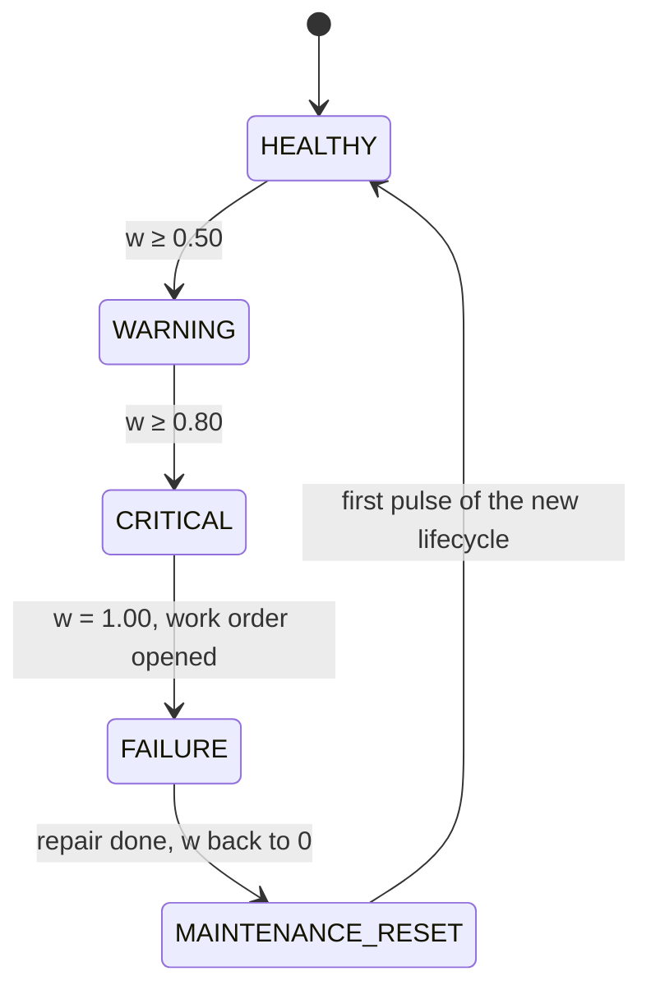

# Machine learning deep dive

The physics that generates the data, the labels and features built from it, and how the RUL model
is trained, validated, promoted and served. For the quick tour, start with the
[README](../README.md).

## 1. Engine physics: a learnable ground truth

Real engine run-to-failure data is scarce, so the simulator
([`simulator/engine_generator.py`](../simulator/engine_generator.py)) generates it from a hidden,
physics-inspired **wear factor** `w(t)` that runs from `0` (fresh overhaul) to `1` (failure). The
model never sees `w`: it has to infer degradation from noisy sensors, exactly like a real engine
health monitoring system.

**One lifecycle** (overhaul → failure) draws its own parameters from a stable hash of
`(SIM_SEED, engine_id, lifecycle_id)`:

```text
expected life   L ~ Normal(μ, 0.18 μ), clipped to [0.55 μ, 1.6 μ]        μ = SIM_MEAN_LIFE_CYCLES (180)
wear curve      c(t) = (t / L)^k                         k ~ U(1.8, 2.8)   polynomial  (p = 0.5)
                c(t) = (e^(b t / L) − 1) / (e^b − 1)     b ~ U(2.5, 4.0)   exponential (p = 0.5)
per pulse       w_i = min(1, Σ [c(t_i) − c(t_i−1)] · s_i),   s_i ~ LogNormal with mean 1, σ = 0.25
```

Both curve families are convex: damage accrues slowly in a healthy engine and accelerates towards
end of life (crack growth, coating loss), which is exactly the shape that makes RUL learnable.

**Sensor response** (B = per-engine baseline with ±1.5 % manufacturing offset, θ = shared operating
condition, an AR(1) process around 1.0, z = Gaussian noise, m = failure-mode sensitivity):

| Sensor | Model | Physical story |
|---|---|---|
| EGT | `B(1 + 0.8(θ−1)) + 110·m·w^2.2 + (4 + 6w)·z` | hot-section efficiency loss, non-linear drift |
| Core temperature | `B(1 + 0.6(θ−1)) + 70·m·w^1.8 + (3 + 4w)·z` | same mechanism, smaller amplitude |
| Vibration | `B(1 + 3.5·m·w^2.5)·e^((0.05 + 0.2w)·z)` + rare spikes (p = 0.002 + 0.03w³) | bearing wear: amplitude **and** variance grow |
| Oil pressure | `B(1 − 0.02w − 0.12·m·max(0, (w−0.7)/0.3)²) + (0.4 + w)·z` − dips (p = 0.04w⁴) | subtle drop shortly before failure |
| Fuel flow | `B·θ^1.5·(1 + 0.05·m·w^1.6) + 0.006·B·z` | specific fuel consumption rises |
| Core speed | `B·θ·(1 + 0.012·m·w^1.5) + 0.002·B·z` | the core spins faster to hold thrust |

Each lifecycle draws a **failure mode** that amplifies its dominant channels (×1.5, others ×0.8):
`HPT_BLADE_EROSION` (EGT, core temperature), `BEARING_DEGRADATION` (vibration), `OIL_SYSTEM_LEAK`
(oil pressure), `COMPRESSOR_FOULING` (fuel flow, rpm, EGT). Every channel still drifts, so RUL stays
learnable whatever the mode.



With the defaults a lifecycle lasts ~180 cycles (CV 0.17, observed range 98–285) of 10 pulses
each, about 30 minutes at 1 Hz. Measured on the live stack, average EGT rises from 657 °C (healthy)
to 786 °C at failure, vibration from 1.33 to 5.98 mm/s, and oil pressure falls from 52.4 to 45.2 psi.

## 2. Labels

For every pulse of a **completed** lifecycle (one that ended in a FAILURE pulse):

| Label | Definition |
|---|---|
| `rul_cycles` | `failure_cycle − cycle_number`, counting down to exactly 0 at the failure pulse |
| `rul_cycles_capped` | `least(rul_cycles, RUL_CAP_CYCLES)` with cap 125: early-life RUL is not identifiable from a healthy engine's sensors, so the regression target is piecewise linear (standard C-MAPSS practice) |
| `failure_within_horizon` | `rul_cycles ≤ RUL_FAILURE_HORIZON_CYCLES` (25): the "remove at the next stop" signal |

In-progress lifecycles are right-censored and never used for training, only for inference. dbt and
the trainer read the cap and the horizon from the same environment variables, and the trainer
warns if the labels it recomputes disagree with the mart's.

## 3. Features

56 numeric features per pulse: the 46 pulse features computed in dbt
([`int_sensor_rolling_features`](../analytics/models/silver/int_sensor_rolling_features.sql)) plus 10
spectral features from the high-frequency path, joined per pulse by the view
[`int_ml_features`](../analytics/models/silver/int_ml_features.sql) and shared verbatim by training
and inference, so there is no train/serve skew:

| Family | Columns |
|---|---|
| Age | `cycle_number` (cycles since the last overhaul) |
| Raw sensors (6) | `rpm`, `core_temp_c`, `egt_c`, `vibration_mm_s`, `fuel_flow_kg_h`, `oil_pressure_psi` |
| Rolling windows (24) | mean, std, min and max over **5 and 15 minutes** for vibration, EGT and oil pressure |
| Dynamics (9) | `*_delta_1` (pulse-to-pulse change), `*_roc_5m` / `*_roc_15m` (change per minute across the window) |
| Drift (6) | EGT and core-temperature drift, vibration ratio, oil-pressure drop, fuel-flow and rpm drift in %, all against an *expanding* baseline of the lifecycle's first 10 cycles |
| Spectral (10, HF path) | 5-minute means of the fan bearing-defect (BPFO) amplitude, fan kurtosis and crest factor, fan 1×N1 and core 1×N2 amplitudes, fan high-frequency energy share, oil temperature, oil quantity, oil filter ΔP and the EGT A/B sensor split |

The spectral features are the only ones allowed to be missing (HF disabled, lagging or a dropped
frame); XGBoost and the classifier treat them as missing values, while a missing pulse feature fails
the job.

Plus `engine_model` one-hot (categories persisted with the model). Windows are time ranges
(`RANGE BETWEEN 300 PRECEDING AND CURRENT ROW` over epoch seconds) partitioned by engine
**and lifecycle**, so a repair never blends two lifecycles. A guard in
[`feature_pipeline.py`](../data_science/feature_pipeline.py) refuses ground truth (`wear_factor`),
status columns, identifiers and labels as features.

## 4. Training and validation

[`train_rul_model.py`](../data_science/train_rul_model.py):

1. **Load** `mart_rul_training_features` from ClickHouse (default) or the newest non-empty gold
   snapshot in MinIO (`--source minio`). The mart holds the newest 50 completed lifecycles per
   engine (dbt var `mart_max_lifecycles_per_engine`) and the trainer loads at most
   `TRAINING_MAX_ROWS` (600 000) rows, newest lifecycles first, so memory stays bounded however
   long the stack runs. Exit code 3 (skipped) below `max(MIN_TRAINING_LIFECYCLES, 3)` completed
   lifecycles, the minimum for a train/validation/test split.
2. **Split by lifecycle.** A lifecycle never appears on both sides. The assignment is a deterministic
   SHA-256 of the lifecycle key (~25 % test, ~20 % of the rest for validation), so a lifecycle
   never migrates from train to test as data grows, and the champion is never scored on its own
   training data.
3. **Regressor:** XGBoost (`max_depth` 5, `learning_rate` 0.03, subsampling 0.8, L2 2.0, up to 2 000
   trees with early stopping on the validation lifecycles) on `rul_cycles_capped`. The saved model
   is trimmed to the best iteration, so `regressor.json` holds exactly the trees that are served.
4. **Classifier:** scikit-learn `HistGradientBoostingClassifier` for `failure_within_horizon`,
   **calibrated** with Platt scaling fitted on out-of-fold scores from a lifecycle-grouped 5-fold
   cross-validation, so `failure_probability` means what it says. The decision threshold maximises
   F1 on those out-of-fold calibrated probabilities, restricted to [0.05, 0.95] with ties broken
   towards 0.5; the threshold, not class re-weighting, handles the imbalance.
5. **Evaluate on the holdout lifecycles:**

| Metric | Meaning |
|---|---|
| RMSE, MAE, R² | against the capped target |
| late-life RMSE | rows with true RUL ≤ cap: the part of life where the prediction matters |
| NASA score | asymmetric C-MAPSS score, mean per row: late predictions (d > 0) cost `e^(d/10) − 1`, early ones `e^(−d/13) − 1` |
| F1, precision, recall, ROC-AUC | imminent-failure classifier at the tuned threshold |
| Brier score, ECE | calibration of `failure_probability` (expected calibration error over 10 bins) |

Example run on the live stack after nine hours (69 calibration lifecycles): **RMSE 15.2 cycles,
R² 0.87**, failure classifier at threshold 0.37 with **F1 0.87 (precision 0.90, recall 0.84),
ROC-AUC 0.99, Brier 0.028, ECE 0.017**. The live backtest of the models trained that day, scored on
the lifecycles that failed after each went live, agrees: RMSE 13–17 cycles, recall 0.88–0.96 and a
median warning 17–30 cycles before the failure.

6. **Spectral ablation (evidence only):** every run also refits both models without the 10
   spectral features on the identical split and scores them on the same holdout. The comparison
   (RMSE, MAE, R², late-life RMSE, F1, ROC-AUC, the spectral share of the regressor's gain, HF
   coverage, extra seconds) is logged and stored as `ablation` in `metrics.json`, `metadata.json`
   and `ml_model_runs.params_json`. It never influences promotion and adds roughly 40 % to a run.

   **What it showed.** One run's holdout is small (3 to 9 lifecycles), so on a fresh stack's 24
   backfilled lifecycles (100 % spectral coverage) the comparison was repeated over 8 different
   lifecycle splits (`split_groups` seeds 1 to 8). With the spectral features the RUL regressor did
   not improve (mean holdout RMSE 12.0 vs 11.4 cycles, worse in 6 of 8 splits), the classifier's
   F1 did not either (0.824 vs 0.836), and only the failure probability was slightly better
   calibrated (Brier 0.033 vs 0.036, better in 7 of 8). In this simulation the fan channel's RMS
   equals the 1 Hz vibration reading by construction and the same wear drives every 1 Hz drift, so
   the frames add failure-mode signatures rather than new information about how far the wear has
   progressed. Those signatures pay off in the bearing-defect flag of the fleet board, which
   fired in every bearing-degradation and oil-leak lifecycle and in none of the 14 hot-section or
   compressor failures.

## 5. Promotion, artifacts and the registry

- **Quality floors.** Every promotion, under any policy, requires holdout R² ≥ `PROMOTION_MIN_R2`
  (0.5) and ROC-AUC ≥ `PROMOTION_MIN_ROC_AUC` (0.75).
- **Champion/challenger.** With `MODEL_PROMOTION_POLICY=better` the production model is re-scored
  on the challenger's holdout (only lifecycles the champion was not fitted on); the challenger must
  have a lower RMSE and may lose at most `PROMOTION_F1_TOLERANCE` (0.05) classifier F1. The gate
  fails **closed**: if the champion cannot be loaded or scored, nothing is promoted and the run is
  recorded with `promoted = 0`. Only a planned change (a different feature schema or bundle format,
  or a legacy pointer without a digest) lets the floors decide alone; a champion trained on the
  46 pulse features is re-scored on its own columns of the same holdout and compared normally.
  `always` skips the
  comparison, never the floors; `make train-ml ARGS="--promotion-policy always"` is the escape
  hatch when a champion is permanently unloadable. `production.json` is replaced atomically.
- **Artifacts** go to `s3://lakehouse/ml-artifacts/rul_model/rul-<UTC timestamp>/`:
  `model_bundle.joblib` (both models, calibration, threshold, feature list, categories, horizon,
  cap, library versions), `regressor.json` (portable XGBoost format, served trees only),
  `metadata.json`, `metrics.json` and `feature_importance.csv`.
- **Integrity.** The SHA-256 of `model_bundle.joblib` is stored in `production.json`
  (`bundle_sha256`), `metadata.json` and the run registry; inference verifies it before unpickling
  and refuses a missing or mismatching digest.
- **Registry.** Every run, promoted or not, appends a row to `ml_model_runs` with data volume,
  holdout metrics, the promotion decision and the artifact URI.
- **Scheduled retraining** uses `--skip-if-unchanged`: it retrains only when the newest completed
  lifecycle moved past the data watermark of the last run.

## 6. Inference

[`predict_rul.py`](../data_science/predict_rul.py) loads the model named by `production.json`,
takes the newest pulse of every engine from the view `int_ml_features` (`LIMIT 1 BY engine_id`;
when that pulse's HF frame has not landed yet, its spectral features come from the engine's newest
landed frame of the same lifecycle at most `SPECTRAL_MAX_LAG_SECONDS` older) and writes to
`gold_engine_rul_predictions`:

| Column | Meaning |
|---|---|
| `predicted_rul_cycles` | regressor output clipped to `[0, cap]` |
| `predicted_rul_hours` | cycles × `FLIGHT_HOURS_PER_CYCLE` (2.0) |
| `failure_probability`, `failure_within_horizon` | calibrated classifier probability and the decision at the tuned threshold |
| `risk_band` | `HIGH` if a failure is predicted within the horizon or RUL ≤ horizon; `MEDIUM` if the probability exceeds half the threshold or RUL ≤ 2 × horizon; otherwise `LOW` |
| sensor columns, `operational_status` | the readings the prediction was made from |

`--mode live --interval-seconds N` keeps scoring in a loop; the orchestrator instead calls
`--mode batch` after every dbt cycle.

## 7. Known limitations

- The data is simulated: the physics is plausible, not calibrated against a real engine type.
- Training is bounded (newest 50 lifecycles per engine, `TRAINING_MAX_ROWS`), and the silver
  snapshot exports only the last `SNAPSHOT_WINDOW_DAYS`; non-promoted model artifacts are still
  kept forever (~1 MB per run).
- A training run fits the classifier about seven times (calibration folds plus the final fit):
  ~40 s at a few hundred thousand rows, a few minutes near the row cap.
- `model_bundle.joblib` is a pickle. The digest protects against a bundle swapped or corrupted
  under an unchanged pointer, not against someone who can rewrite `production.json` as well: keep
  the bucket writable only by the training job (and the ports bound to loopback).
